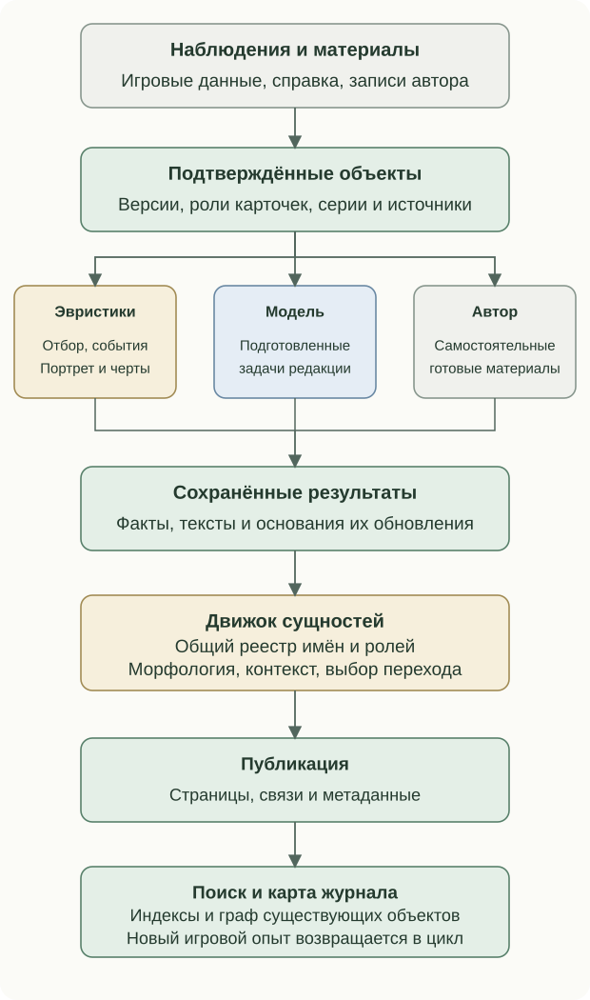

# Устройство Аркадного зала

Аркадный зал объединяет наблюдения об игре, справочные сведения, авторские материалы и подготовленные тексты. Смысл формируется несколькими способами: правилами отбора, вычисляемыми характеристиками, редакционными заданиями модели и связями между сущностями.

## Основания материалов

| Материал | Пример | Роль в системе |
| --- | --- | --- |
| Наблюдение | Полученное достижение, время игры, личный результат | Фиксирует событие или состояние |
| Справочный факт | Платформа версии, дата, подтверждённая серия | Определяет объект и его связи |
| Авторская запись | Заметка, список признания, описание реконструкции | Задаёт самостоятельный материал и редакционную позицию |
| Вывод правила | Подходящая игра, изменение состава, подтверждённая черта | Подготавливает отбор или основание задачи |
| Текст модели | «Взгляд», историческая колонка, подводка журнала | Формулирует ответ на подготовленный редакционный вопрос |

## Общий ход работы

Получение внешних данных, подготовка новых материалов и сборка страниц имеют собственные режимы запуска. Обычная сборка использует сохранённые результаты; плановые и явные редакционные операции выполняют соответствующие обновления. На каждом этапе сохраняется уже выполненная работа.

Полная карта генераторов, их входов и результатов приведена в [разборе смыслового движка](meaning-system.md).

Карта остальных движков, включая музыку и воспроизведение, генераторы OpenGraph, семантические теги, медиаархив, темы и лабораторию, приведена в [устройстве компонентов](site-engines.md).

## Связи, которые определяют поведение каталога

| Механизм | Правило проекта | Что получает читатель |
| --- | --- | --- |
| История с обратной силой | Новое подтверждённое состояние проверяет основания уже сохранённых материалов | Прежняя карточка может измениться вместе с игровым опытом |
| Несколько взглядов на одну версию | Недельное знакомство, личный опыт и справочный контекст имеют собственные роли | Совместный текст сохраняет связь с двумя исходными описаниями |
| Рекомендации и характеристика | Правила готовят основания; модель получает конкретную редакционную задачу | Выбор игр и черты можно связать с подтверждающими наблюдениями |
| Реестр сущностей и семантические теги | Идентичности связывают текст, переходы и граф страницы | Поиск, перелинковка и машинное описание согласуются с опубликованным материалом |
| Компоновщики OpenGraph | Проверенные материалы карточек и серий превращаются в собственные превью | У ссылки есть образ конкретной страницы, рубрики или серии |
| Музыкальный движок | Подбор набора, очередь, метаданные и браузерный декодер образуют единый контур | Музыку конкретной игры можно найти и воспроизвести в карточке и библиотеке |
| Темы и лаборатория | Оформление и реконструкции подключаются через собственные пакеты и явные связи | Календарная тема, игры подборки и работающая реконструкция сохраняют свои роли |

## Идентичность и роли

Произведение, платформенная версия и карточка раздела — разные сущности. Одна версия может присутствовать в недельном выпуске, личном опыте, планах или рекомендациях. Общие сведения передаются через подтверждённую идентичность; роль карточки сохраняется отдельно.

| Сущность | Основание связи |
| --- | --- |
| Версия игры | Идентификаторы источников и платформа |
| Недельная и личная карточка | Совпадающие RA ID и платформа |
| Серия | Подтверждённые источником участники и собственная идентичность |
| Признание | Запись конкретного списка с областью действия: произведение или версия |
| Реконструкция | Собственный объект лаборатории, связанный с историческим оригиналом |
| Автор и персонаж | Явные сведения страницы «О проекте» |

Сопоставление объектов и распознавание их упоминаний в тексте решают разные задачи. Идентификаторы подтверждают связь карточек. Движок сущностей распознаёт зарегистрированные названия в опубликованной прозе и выбирает допустимый переход.

## Что публикуется

Страницы собираются из фактов, редакционных блоков, связей и готовых медиа. Общий реестр сущностей используется для перелинковки и структурированных метаданных. По опубликованным страницам и переходам строится карта журнала.

Пакеты тем добавляют оформление, календарь и подборку игр. Лаборатория публикует работающие реконструкции с описанием оригинала, источниками и сведениями о точности модели. Эти материалы включаются в общий каталог через собственные записи и подтверждённые связи.

Порядок чтения: [Оглавление](../README.md) · Назад: [Медиатека, просмотр и поиск](media.md) · Далее: [Движки и контуры Аркадного зала](site-engines.md)
