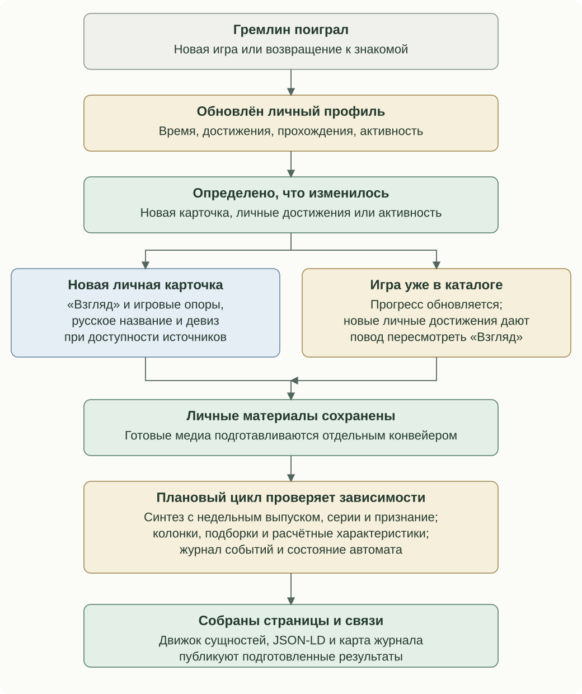
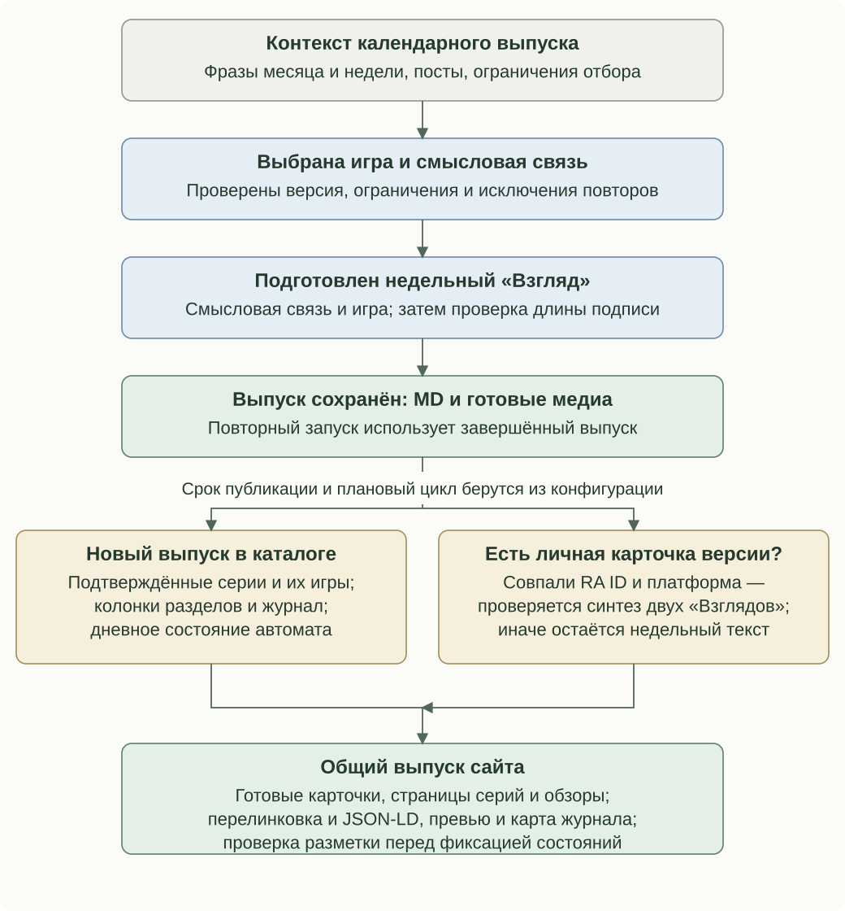

# Когда обновляются материалы

У смысловых задач разные основания. Изменение каталога даёт повод проверить конкретную зависимость, а правила этой задачи определяют дальнейшее действие.

## Гремлин поиграл

Обработка сыгранной игры запускает цепочку изменений: обновляется личный профиль, определяется новое состояние игры, затем пересматриваются её карточка и зависимые материалы. Для новой и уже знакомой игры цепочка расходится в условиях подготовки текста и медиа.

| Ситуация | Работа с личной карточкой | Дальнейшие зависимости |
| --- | --- | --- |
| Новая игра в полученном профиле | Создаются «Взгляд» и игровые опоры. При доступности источников добавляются девиз и устоявшееся русское название. MD сохраняется до подготовки изображения | Игра входит в личный набор, связывается с сериями, признанием и существующими карточками той же версии |
| Знакомая игра, изменились личные достижения | Прогресс сохраняется, личный «Взгляд» пересматривается по изменению состава и режима полученных достижений. Готовые медиа обновляются своим этапом | Может измениться основание синтеза с недельной карточкой, расчётные черты, достижения, рекорды и события |
| Знакомая игра, выросло время или появилась новая активность | Обновляются наблюдения. Сам рост времени не является условием автоматической замены личного «Взгляда» | Новые наблюдения могут повлиять на отбор, портрет, характеристику и подтверждённые возвращения |
| Источник вернул неполные данные | Отложенные игры сохраняют прежние подтверждённые сведения; успешно подготовленные материалы остаются на месте | Зависимые этапы используют сведения о полноте; отсутствие ответа не превращается в доказанное исчезновение результата |

Данные приходят из RetroAchievements при сборе профиля. Синхронизация сначала сохраняет профиль, затем обрабатывает личные карточки. Готовый суточный снимок может быть переиспользован; полнота и время подтверждённого сбора сохраняются отдельно. В первом полном цикле старые карточки получают основание сравнения: это предотвращает массовую замену текстов при введении нового правила. Повторный запуск продолжает незавершённую работу с уже сохранёнными результатами.

После карточек проверяются зависимые материалы. Если для той же версии существует недельный выпуск, синтез сопоставляет два исходных «Взгляда». История и место в серии читают уже накопленный контекст. Новая лично сыгранная игра может изменить статус участника серии и основание обзора этой серии. «За что её помнят» готовится только для подходящей личной версии, представленной в признании.

Рекомендации, общий обзор личных игр и литературная характеристика имеют собственные условия запуска. Они не вызываются безусловно для каждого нового достижения.

## Пришла игра недели

У недельного выпуска два этапа: подготовка материала и включение в каталог по календарю. День и время публикации, часовой пояс и окно фиксации задаются конфигурацией. Заранее подготовленный MD не означает, что будущий выпуск уже должен появиться на сайте.

1. Генератор читает фразы месяца и недели, а также посты за нужный период. Ограничения платформ и годов приходят из общего справочника отбора. Повторы исключаются по существующим завершённым выпускам с учётом настроенного окна.
2. Выбор возвращает конкретную игру и смысловую связь с редакционным контекстом. Ответ проверяется до перехода к описанию.
3. Недельное описание получает игру, смысловую связь и бюджет подписи. При превышении лимита выполняется до трёх сокращений с сохранением выбранного угла. Готовые медиа подготавливаются отдельным конвейером.
4. Завершённый выпуск сохраняется как MD, медиа и состояние выполнения. Повторный запуск использует готовый материал. Явное пересоздание и исправление текста - самостоятельные операции.
5. При наступлении срока каталог допускает выпуск к публикации. Полный плановый цикл обновляет прогресс прошлых недельных игр и личный профиль, готовит недостающие планы, проверяет рекомендации и общий обзор личных игр, затем проверяет совпавшие недельные и личные карточки для синтеза.
6. Во время сборки уточняются подтверждённые серии и их участники, создаются недостающие справочные карточки. Поэтому вместе с выпуском могут появиться другие игры его серии. Это отдельные справочные материалы со своей ролью.
7. Проверяются тексты серий, история и контекст подходящих личных игр, признание и колонки разделов. Журнал сравнивает подтверждённые состояния; аналитика рассчитывает портрет и характеристику. Дневной автомат учитывает выход недельного выпуска и появление связанных карточек в тот же день.
8. Страницы получают связи сущностей и структурированные метаданные. По опубликованным материалам строится карта журнала. После проверки разметки фиксируются состояния наблюдения и событий.

Если личной карточки той же RA-версии и платформы нет, совместный «Взгляд» не создаётся. Готовое недельное описание остаётся самостоятельным. Появление личного опыта позднее может дать основание для синтеза уже вышедшего выпуска.

Новый опубликованный выпуск открывает окно проверки общего обзора личных игр. Новый текст возникает только при изменении пригодного набора опыта; сам календарный переход не требует замены колонки.

## Режимы запуска

| Режим | Что делает до сборки | Какие смысловые задачи доступны |
| --- | --- | --- |
| `build` | Читает сохранённые материалы | Собирает страницы и связи из готовых результатов; полный плановый редакционный цикл не выполняет |
| `scheduled` | Обновляет прогресс недельных игр и профиль, создаёт недостающие планы, проверяет рекомендации, личный обзор и синтез | Запускает включённые в конфигурации плановые задачи, затем собирает сайт |
| `scheduled-profile` | Синхронизирует личный профиль и проверяет синтез только уже опубликованных недельных выпусков | Переходит к плановой сборке с обновлением зависимых материалов; отдельные предварительные шаги полного `scheduled` не повторяет |
| Явное редакционное обновление | Выполняет выбранную задачу с её параметрами | Может заполнить пропуски или принудительно пересмотреть конкретный материал в пределах команды |

Стрелки на схемах показывают зависимости материалов. Сетевые обращения выполняются с учётом настроек, сохранённых данных и условий конкретной задачи. Отправка сообщения в канал и включение выпуска в каталог имеют собственные состояния публикации.

## Основания пересмотра

| Материал | Основание | Автоматическое поведение |
| --- | --- | --- |
| Совместный «Взгляд» | Два исходных текста, ключ выпуска, RA ID и платформа | Готовится при отсутствии результата или изменении основания пары |
| «Взгляд» конкретной серии | Подтверждённые участники и их личный статус | Отслеживает добавление, исключение и смену статуса; существующее состояние нормализуется по известным прежним обозначениям |
| «Место в серии» личной игры | Набор подтверждённых серий, в которых состоит сама карточка | Сохраняется при добавлении соседней игры; пересмотр связан с изменением серий этой карточки, отсутствием текста или явным обновлением |
| «Место в истории» | Версия и уже изложенный контекст | Сохранённый управляемый раздел удерживается; отсутствующий или прежний неуправляемый блок обрабатывается соответствующим редакционным этапом |
| Справочный «Взгляд» участника серии | Подтверждённая версия и её группы | Заполняется при отсутствии текста; готовое описание удерживается |
| «За что её помнят» | Признание конкретной личной версии | Заполняет недостающие подходящие материалы, готовые тексты сохраняет |
| Общий «Взгляд» личных игр | Состояние пригодного игрового опыта и вышедший недельный выпуск | Новый опубликованный выпуск даёт окно проверки; состояние отбора определяет необходимость новой колонки |
| Колонки остальных разделов | Подготовленный набор данных своей рубрики | Сравнивают сохранённое основание и заполняют отсутствующий или изменившийся результат |
| Переводы | ID и исходные строки достижений или таблиц | Обрабатывают недостающие и изменившиеся исходные записи |
| Журнал событий | Разница подтверждённых состояний | Сохраняет новые факты и отдельную подводку; первый снимок задаёт базу сравнения |
| Литературная характеристика | Расчётные черты и их подтверждающие произведения | Хранит результат и состояние попытки для конкретного основания |

Явные редакционные команды могут запросить пересмотр. Их область действия задаётся конкретной задачей.

## Первое знакомство и личный опыт

Недельная публикация и личная карточка связываются по совпадающим RA ID и платформе. Синтез получает два текста, название, год и платформу, затем сохраняет отдельный результат. Исходные документы остаются самостоятельными.

В [примере кода](../examples/view_revision.py) основание зависит от двух взглядов, ключа выпуска, RA ID и платформы.

## Изменения серии

Сравнимое состояние содержит идентичность серии, участников и признак личной игры. Известные прежние обозначения приводятся к текущим до сравнения. Так появление новой игры отделяется от переименования записи, а переход справочной игры в личную становится самостоятельным изменением контекста.

Текст конкретной серии и раздел личной карточки используют разные правила. Первый следит за составом и личным статусом участников. Второй описывает место своей версии и удерживается, пока сохраняется набор её подтверждённых серий. Эти различия видны в причинах запуска, а не только в контрольных суммах.

Функции подготовки состояния и объяснения изменений приведены в [примере сравнения серий](../examples/series_revision.py).

## Полнота наблюдения

Сбор данных сохраняет сведения о полноте и времени наблюдения. Частичный ответ источника учитывается отдельно от подтверждённого изменения. Существующий материал остаётся доступным при отложенном обновлении.

Дневное состояние игрового автомата сопоставляется с календарём выхода недельной игры. Время берётся из настроенного расписания. Выход выпуска и появление связанных карточек могут дополнить состояние в тот же день; устаревший профиль отделяется от нового подтверждённого сбора.

## Происхождение текста

Поведенческие сигналы помогают оценить вовлечённость. Сгенерированный редакционный текст описывает игру, а авторская заметка сохраняет собственное происхождение. Это различие проходит через отбор рекомендаций, характеристику и контекст колонок.

Порядок чтения: [Оглавление](../README.md) · Назад: [Смысловой движок](meaning-system.md) · Далее: [От данных к тексту и иллюстрации](prompt-pipeline.md)
