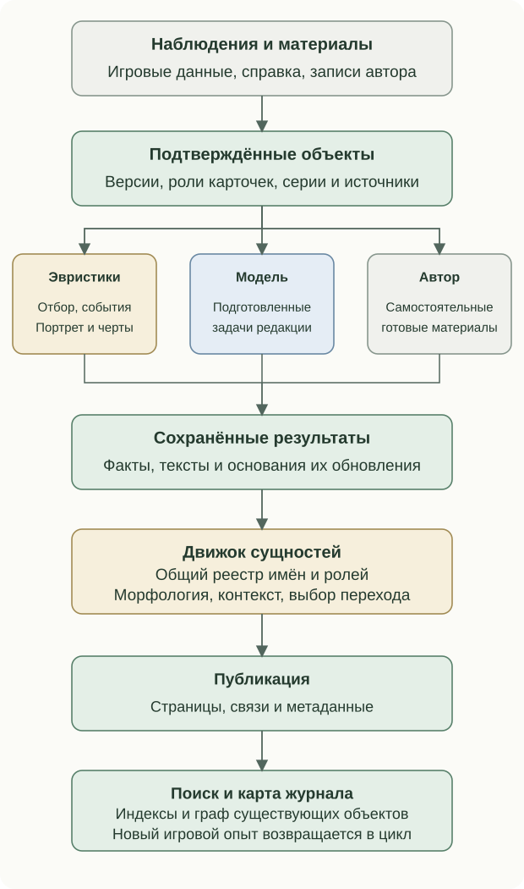

# Architecture of the Arcade

The Arcade combines observations of play, reference facts, authored materials and prepared texts. Meaning comes from selection rules, calculated traits, editorial questions and relationships between entities.

| Material | Example | Role |
| --- | --- | --- |
| Observation | Achievement, playtime, personal result | Records an event or state |
| Reference fact | Platform version, date, confirmed series | Establishes identity and relationships |
| Authored record | Note, recognition list, reconstruction account | Defines an independent material and editorial position |
| Rule output | Eligible game, membership change, supported trait | Prepares a selection or task basis |
| Model text | Perspective, historical column, journal introduction | Answers a prepared editorial question |

## Overall flow

External acquisition, new material preparation and page composition have separate execution modes. Ordinary builds consume saved results; scheduled and explicit editorial operations perform their own updates. Completed work is retained at each stage. See the [semantic engine](meaning-system.md) and [component map](site-engines.md).

## Relationships that determine behaviour

| Mechanism | Project rule | Reader-visible result |
| --- | --- | --- |
| Retrospective narrative | A confirmed new state checks the bases of saved material | Earlier cards may evolve with experience |
| Several perspectives on one version | Weekly discovery, personal experience and reference context retain roles | Synthesis remains linked to both source descriptions |
| Recommendations and characterisation | Rules establish evidence; models receive specific editorial tasks | Choices and traits have supporting observations |
| Entities and semantic tags | Identity joins prose, navigation and the page graph | Search, linking and metadata agree |
| OpenGraph composition | Verified card/series materials produce previews | Each link identifies its particular page |
| Music | Acquisition, queues, metadata and decoding form one subsystem | A game's music plays in its card and library |
| Themes and laboratory | Packages and explicit relationships connect independent objects | Artwork, game selections and reconstructions retain roles |

A work, platform version and section card are different entities. One version may appear in a weekly issue, personal collection, plans or recommendations. Confirmed identity shares facts without erasing roles. Matching RA ID and platform joins weekly/personal cards. Series membership comes from confirmed sources. Recognition has an explicit work/platform/version scope. Reconstructions identify their historical original; authors and characters come from explicit About declarations.

Record matching differs from mention recognition. The former establishes relationships; the latter finds registered names in prose and chooses valid navigation. Pages combine facts, editorial blocks, relationships and ready media. The shared registry supports links and structured metadata; the journal graph represents published pages and declared relations. Laboratory descriptions, sources and accuracy statements remain in their own projects.

Reading order: [Contents](../../README.en.md) · Previous: [Media library, viewing and search](media.md) · Next: [Components and subsystems](site-engines.md)
