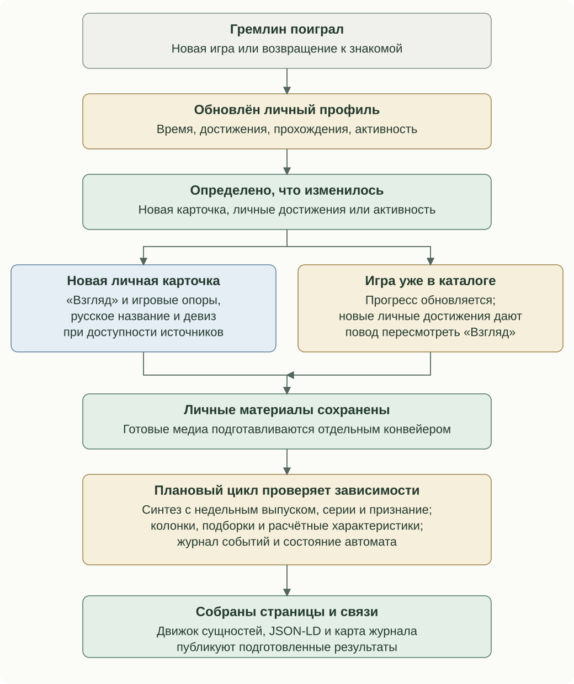
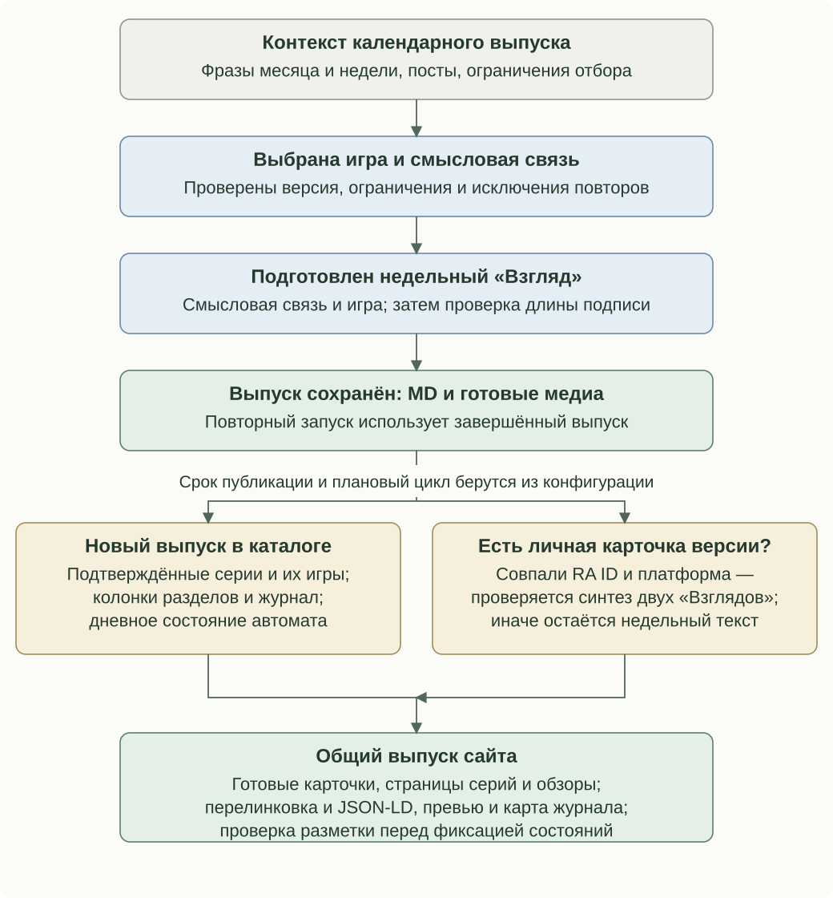

# When materials change

A catalogue change checks a particular dependency; that task's own policy determines whether it needs new work.

## Gremlin plays

| Situation | Personal card | Dependencies |
| --- | --- | --- |
| A new game in a confirmed profile | Create Perspective and gameplay anchors; add verified title/tagline when available; save text before artwork | Join the personal set, series, recognition and cards of the same version |
| Achievements change | Save progress; revise Perspective from changed achievement membership/mode; media has its own stage | Synthesis basis, traits, achievements, records and events may change |
| More playtime/activity | Update observations; time alone does not automatically replace Perspective | Selection, portrait and confirmed returns may change |
| Partial source response | Retain confirmed facts and successful material for deferred games | Missing responses do not prove a result disappeared |

RetroAchievements supplies the profile. It is saved before personal cards are processed. A valid daily snapshot may be reused; completeness and observation time are distinct. The first full cycle establishes comparison bases for old cards, preventing a newly introduced policy from rewriting everything. Retries continue from saved work.

Matching weekly/personal versions may trigger synthesis. History and series context consume accumulated material. Personal participation may alter a series review's basis. Recognition writing requires an eligible personal version present in confirmed recognition lists. Recommendation selection, overview writing and literary characterisation have independent triggers.

## A weekly game arrives

Preparation and calendar admission are separate. A future prepared issue is not already published. The issue reads month/week phrases and channel posts; shared references constrain platforms/years; completed issues exclude repeats within the configured window. Selection returns a particular version and editorial connection and is validated first. Writing receives that connection and a caption budget; up to three shortening attempts preserve the chosen angle. Media preparation is independent.

A complete issue saves Markdown, media and execution state. Repeating preparation reuses it; explicit recreation and repair are separate. At the scheduled instant it becomes eligible for the catalogue. A full scheduled cycle updates earlier weekly progress/profile, missing plans, recommendations, personal overview and eligible syntheses. Confirmed series and missing reference cards may add other games with reference roles. Series writing, history, recognition and section columns follow their own checks. Journal facts compare confirmed states; analytics derives portrait and traits. The daily game state considers the issue and related cards arriving that day. Entity links, metadata and the journal graph are published before observation/event checkpoints are finalised.

Without the same RA version/platform's personal card there is no synthesis. A later personal experience may enable synthesis of an earlier issue. Publication opens an overview-check window; a new overview still requires the eligible experience set to change.

## Execution modes

| Mode | Behaviour |
| --- | --- |
| build | Compose from saved results, without the complete scheduled editorial cycle |
| scheduled | Update weekly progress/profile, missing plans, recommendations, personal overview and synthesis, then build |
| scheduled-profile | Sync profile and eligible published weekly syntheses, then update dependencies/build without repeating the full scheduled prelude |
| Explicit editorial operation | Fill or revise the selected task within its own scope |

Diagram arrows represent dependencies, not unconditional network calls. Channel delivery and catalogue admission maintain separate publication states.

## Revision bases

| Material | Basis and automatic policy |
| --- | --- |
| Combined Perspective | Exact two texts, issue key, RA ID/platform; create if absent or changed |
| Series Perspective | Confirmed membership and personal status; normalise known former identities before comparing additions/removals/status changes |
| A personal game's place in its series | That card's confirmed series set; adding a neighbouring game alone does not replace it |
| Place in history | Version and existing context; retain managed sections, fill missing/older unmanaged material through its own operation |
| Reference participant Perspective | Fill missing descriptions, retain completed ones |
| Why remembered | Fill eligible personal versions with recognition evidence, retain existing text |
| Personal overview | Eligible experience and a published weekly check window |
| Other section columns | Their own prepared dataset and saved basis |
| Translations | Achievement/table IDs and source strings; missing or changed originals |
| Journal | Confirmed state differences; first observation establishes a baseline |
| Literary characterisation | Calculated traits and supporting works; save both output and attempt state |

The [perspective example](../../examples/view_revision.py) uses both source texts and identity. The [series example](../../examples/series_revision.py) distinguishes added/removed members and personal-status changes from known renaming. Series reviews and a game's series-context section intentionally have different revision policies. Partial observations are not confirmed removals; a stale profile differs from a new complete observation. Behavioural engagement signals, generated editorial writing and authored notes retain separate provenance.

Reading order: [Contents](../../README.en.md) · Previous: [The semantic engine](meaning-system.md) · Next: [From data to writing and artwork](prompt-pipeline.md)
