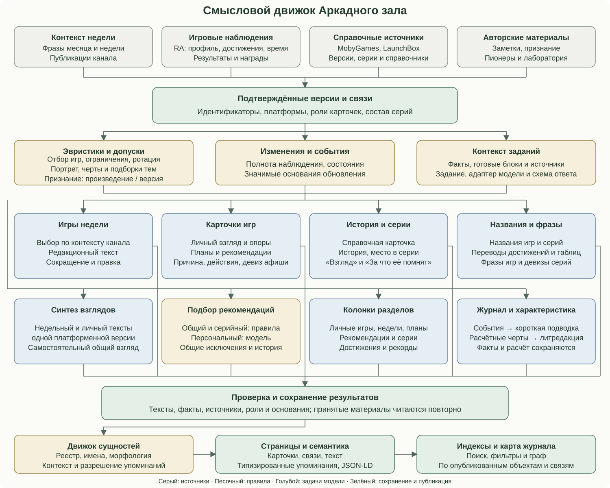
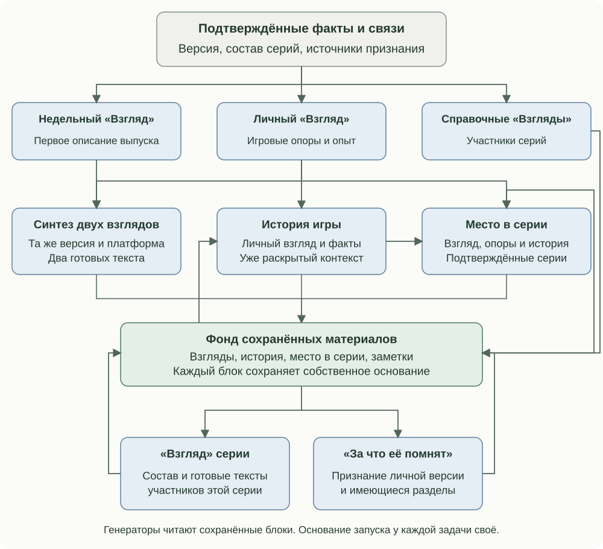
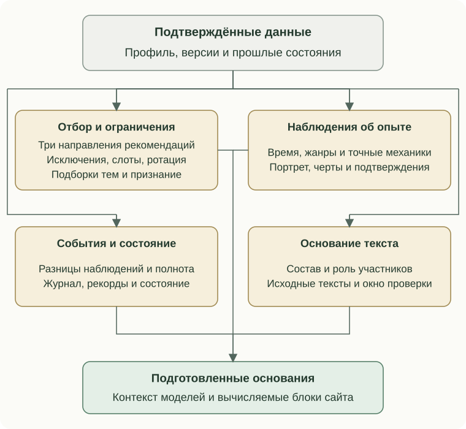
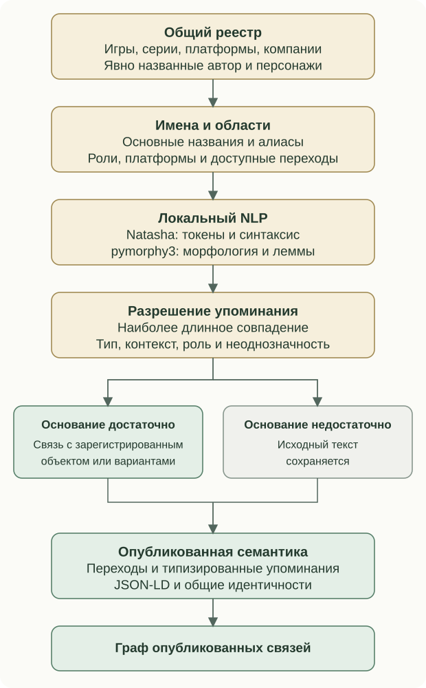

# The semantic engine

Identity algorithms, heuristics, editorial generators and a local entity resolver work together. Models receive prepared questions/context; rules determine admissible data, execution bases and where results belong.





Tasks read available saved material, own their results and check their own bases. First impressions feed synthesis; game histories feed series context; confirmed recognition supports a distinct editorial section. A dependency does not require every related text to be recreated simultaneously.

## Heuristics and selection



Version matching uses RA/platform, confirmed external IDs and aliases. Personal overview selection initially requires over 20 minutes and at least three achievements. General recommendations use community engagement and rarity, series recommendations use confirmed membership and personal involvement, and model selection receives an explicitly admissible catalogue. Rotation retains age/history. Analytics combines confirmed roles, progress, time, series/results and events; the portrait logarithmically weights known playtime and tests data coverage. Traits require evidence; event extraction compares confirmed states and completeness. Daily state also respects the weekly issue's calendar boundary. Characterisation is independent of model recommendation selection and is not automatically supplied as its input.

Three recommendation streams each have five slots. Suitable saved choices remain; new choices fill vacancies. Shared identity exclusions include played games, plans, weekly issues, other selections and recommendation history.

### General algorithm

Use up to the profile's top three platforms; reproducible catalogue traversal hashes profile/RA ID rather than treating provider order as popularity. Candidates require a valid ID/platform, at least three achievements and 30 participants; unofficial/occupied records are excluded. Set rarity is summed TrueRatio divided by ordinary achievement points.

```text
score = 0.55 * popularity + 0.25 * rarity_fit + 0.20 * platform_affinity
```

Popularity normalizes log(1 + players). The profile rarity target is clamped to 1.5–3.5, default 2.3; fit uses a broad Gaussian with parameter 1.3. Genre information adds at most 0.1; repeated selected genres incur a small 0.03 penalty per maximum overlap count. Initially prefer at most two games per platform; remaining vacancies may exceed this soft limit. Rarity is not difficulty.

### Familiar series

Aggregate known playtime and earned points across each confirmed series' unique personal members. Choose the next series primarily by accumulated time divided by occupied slots plus one; points break ties in the same way. Prefer its earliest eligible edition, then smaller RA ID. Existing suitable slots remain.

### Personal model selection

Up to ten context games use a reproducible engagement score:

| Signal | Weight | Definition |
| --- | --- | --- |
| Time | 0.30 | Log hours normalized to the profile's 95th percentile, capped |
| Achievements | 0.25 | Fraction earned for that version |
| Confirmed result | 0.25 | Rarity of attained status/progress/rank in the relevant population |
| Rare earned achievements | 0.20 | Sum of 1-share below 20% attainment, saturating after three units |

The model receives all available eligible RA candidates on the general selection's platforms after exclusions, and fills available slots. No genre/series/platform quota is imposed. Validate returned RA IDs, uniqueness, explanation and suggested first action; titles/platforms/links come from catalogue facts. Save the accepted selection before card preparation.

### Rotation, weekly choices and themed sets

Defaults rotate one oldest eligible recommendation older than 30 days per seven-day interval across all three streams. Moving to played/planned frees a slot separately. Archive and original admission date remain; reprocessing does not restart age. Weekly context uses month/week phrases, channel posts, allowed years/platforms and completed issues' repeat window, possibly all history. Prepared issues are reused unless explicitly regenerated.

Themed selections contain up to ten games: explicit positions first, then platform/series rules, deterministically sorted by normalized title/platform/key, merging duplicate versions. Match confirmed IDs or title/platform. Unresolved entries remain reference positions labelled outside the catalogue, optionally linking an explicit RA ID. Laboratory entries have separate IDs and require description/run pages. Optional selection errors differ from missing required theme artwork. Recognition attaches source records with work/platform/version scope; personal recognition writing and Pioneer/laboratory identity remain distinct.

## Portrait thresholds

Use confirmed personal editions with more than 60 seconds of play; short, unknown and unconfirmed observations remain separate. Merge editions of a work before logarithmic weighting while displaying actual time.

| Observation | Evidence |
| --- | --- |
| Leading platform | Three works and at least 50% of known time |
| Leading series | Two works and at least 25% of known time |
| Stable mechanic | Three works in each of two views; persists outside the dominant series at at least 35% weight in both |
| Rare achievement | Confirmed attainment no greater than 5% |
| Unfinished episode | Eligible unfinished game, preferring independence from the leading series |
| Individual game | Fallback when broader evidence is insufficient |

Show up to five supporting cards. Up to two short interest directions prefer profile genres, then confirmed mechanics, then broad genres. Require at least 60% information coverage, three works per direction and 20% weight share.

## Calculated traits

| Trait | Thresholds |
| --- | --- |
| Hardcore player | Ten achievements; mode known for at least 80%; three games and two Hardcore completions; at least 80% Hardcore share |
| Platform regular | Three works and 20% of the played shelf on that platform |
| Platform expert | Also three completed works and 60% platform-shelf completion |
| Series regular | Three familiar works and 60% of the visible catalogue membership |
| Series master | At least 80% familiar and 60% complete; overlapping source groups merge at 60% full-membership similarity |
| Explorer | 40% outside the leading platform; three platforms at 5% each and three decades at 10% each, with two games per group |
| Rare trophy | Achievement at no more than 5% in a population of at least 1000 |
| Rarity hunter | Three such achievements across two works |
| Tough challenge | Complete consistent community data for three works; median progress lift at least 1.5 and three supporting games |
| Honour board | Three results across two works in the top 10% of tables with at least 100 participants |
| One more run | Confirmed post-completion play on two days at least seven days apart, each over 60 seconds |

Series coverage means catalogue membership, not every possible release. Select a work's primary edition by playtime while retaining port identities. Community comparisons require a complete consistent achievement set and one known population of at least 100.

Character priorities prefer Hardcore, arcade, other platforms and exploration, falling back to the first supported trait. Strength priorities are series, rarity, comparative progress and competition. Unused exploration may become a distinctive feature. An unfinished episode requires three completed works, at least one hour in an unfinished game and less than one quarter of its achievements; select the longest eligible episode. Literary revision requires at least two calculated traits.

Rarity thresholds are task-specific: daily state uses at most 10% with at least 100 players; selection signal below 20%; portrait observation at most 5%; rarity trait at most 5% with at least 1000 players.

## Editorial task families

Weekly selection returns version, gameplay anchors and an editorial connection. Issue writing returns text, angle, used anchors and scene intent; shortening/repair have independent constraints. Personal cards read available/earned achievements; planned and recommended cards introduce the game's possibilities. Missing anchors may be filled without replacing an existing Perspective. Recommendation explanation, first actions and a poster motto use the saved selection reason; planned cards have their own first actions. Synthesis combines the weekly and personal perspectives of one version.

Reference series members receive short descriptions. Place in History reads version, Perspective and available series material; Place in Series reads personal Perspective, anchors, history and confirmed groups. Series reviews receive membership and saved participant texts. Why Remembered receives confirmed recognition for the personal version. Each owns separate output and trigger policies.

Verified Russian game/series names, achievement/table translations, authentic game phrases and series taglines are separate tasks. Authentic quotations retain sources and translations; a recommendation poster's authored motto is editorial writing. Repair can verify an existing phrase's original source.

Columns for personal games, weekly issues, recommendations, plans, series, achievements and records consume their respective prepared sets. The journal preserves factual event differences even if an introduction cannot be generated. Characterisation first computes trait, evidence and explanation; literary revision edits these statements with a saved attempt state. The calculated text remains usable after a failed literary pass.

## Local entity engine



The registry includes catalogue games, series, platforms and companies, plus explicitly declared About author/persona/contacts. One version chooses a preferred card while retaining alternative known names. Natasha segmentation/syntax and pymorphy3 morphology produce tokens/lemmas; a sequence index prefers the longest registered match.

Common-word titles require formatting/type context. Short names inside longer names need independent evidence. Explicit context chooses game versus series; otherwise games take priority. Remaining ambiguity skips a link; several confirmed game versions may remain reader choices. Platform adjectives require version/port/game context. Developer/publisher syntax chooses the correct company filter. Self-links are omitted. Explicit authored links, code, controls and excluded markup are preserved.

The shared identity registry supports HTML links and structured data independently. The graph represents published pages and declared relations; links do not prove historical claims. Search/filter metadata consumes prepared facts.

Each task checks configuration, eligibility, absent output or meaningful basis changes. Full scheduled processing joins profile/cards/recommendations/synthesis/series/editorial work and publication; the nightly profile cycle updates observations and eligible already-published weekly syntheses. Changing model, paths or prompt wording alone preserves completed material where the task basis is defined by subject data. See [revision policies](editorial-feedback.md).

Reading order: [Contents](../../README.en.md) · Previous: [Components and subsystems](site-engines.md) · Next: [When materials change](editorial-feedback.md)
