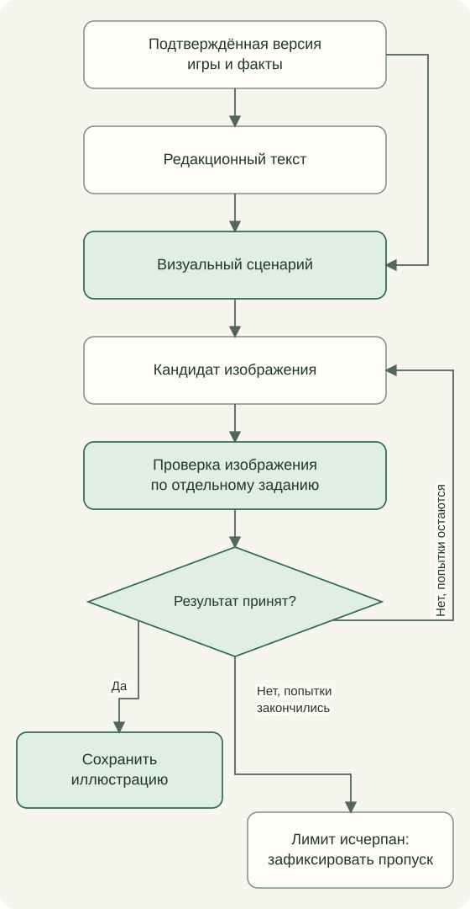

# From data to writing and artwork

The pipeline joins selection rules, prepared context, a prompt, a structured answer, validation and a saved result. The same prompt with different facts can express different meaning; one event need not update everything.

| Task | Editorial question |
| --- | --- |
| Personal card | How does this game read in the observed play experience? |
| Planned card | What should the reader try in an unplayed game? |
| Recommendation | Why try this game next? |
| Perspective synthesis | How do first discovery and subsequent experience of this version combine? |
| Place in series | What distinguishes this version among confirmed participants? |
| Series review | How do participants and their development connect? |
| Recognition | Which properties kept the game historically memorable? |

A generic request to elaborate does not replace distinct editorial questions.

Poster checks consider purpose, identifiable game details, characters and composition. Model review does not guarantee anatomy or historical accuracy; a separate prompt defines its criteria. Personal posters evoke the game's period, planned cards introduce its world, and recommendations use contemporary spectacle. Scene planning joins that visual language to a particular game.

Research receives known facts and search constraints. Sources remain with validated results. Ordinary builds consume saved results; external research and paid generation are separate. The [prompt index](../../prompts/README.md) shows input, output and next step for every task. Weekly selection, personal/planned/recommended cards, synthesis, history, recognition, names, translations, columns and journal each have their own tasks. Character references accompany visual tasks involving Gremlin and Fox. A common adapter submits a prepared task/context; task validators check the answer before saving it. See [editorial contracts](contracts.md) and [semantic engine](meaning-system.md).

Reading order: [Contents](../../README.en.md) · Previous: [When materials change](editorial-feedback.md) · Next: [Navigation, accessibility and metadata](accessibility.md)
