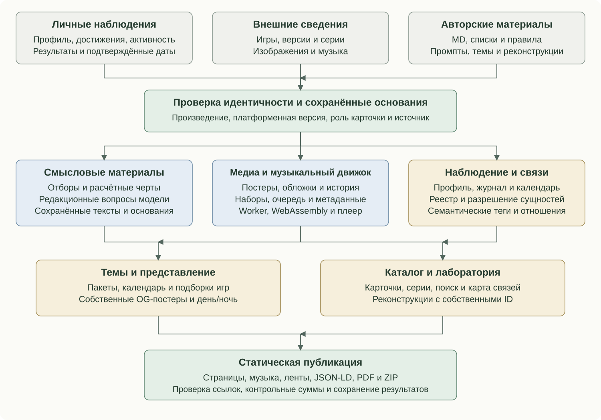

# Components and subsystems

The Arcade joins play experience, editorial material and interactive components. Music, media, themes, laboratory, search and publication each own their data/update rules.

## Data, versions and personal material

RetroAchievements supplies profile, achievements, modes, completion and activity. Configured references enrich edition/developer/genre/series facts, including MobyGames and LaunchBox; IGDB support does not imply it is enabled. Sources have distinct authority. Work, platform version and section card retain identities. Normalization handles names, companies, genres, player modes and date precision. Observation time differs from event date; partial responses retain completeness metadata.

Rules derive engagement, portrait, traits and three recommendation streams. Confirmed series connect personal/reference members. Perspective, history, series context, recognition and columns consume prepared data and retain their own revision bases. Details are in the [semantic engine](meaning-system.md) and [update policies](editorial-feedback.md).

## Music acquisition and playback

A version's identity/platform determines compatible providers and source files. Acquisition parses tracklists, subsongs and durations; hashes deduplicate physical files. Ready manifests remain separate from source bytes. A build validates identity, platform, tracklist and expected file sizes before exposing a player. Acquisition has scheduled/explicit stages. Current extensions include weekly/series libraries, Android applications and acoustic selection; see [music](music.md), [API](music-api.md) and [analysis](music-similarity.md).

Cards and the media library share playback state: set, track, position, status and volume. A local search index loads separately from complete manifests/audio. Ordinary recordings use browser audio; native game formats use a Game Music Emu WebAssembly worker feeding PCM to AudioWorklet, with a bounded scheduled AudioBuffer fallback for local HTTP viewing. Pause, resume, switching and fade retain distinct states. Request generations reject obsolete loads; repeated clicks on a loading track retain one active start. Switching releases old transport resources and volume persists locally. The current YM2413 source is shared with GremlinAmp.

MusicPlaylist/MusicRecording metadata joins the canonical VideoGame. Known duration and performer credit follow saved evidence; game titles do not establish composer identity, regional identity or licensing. Source pages retain provenance and decoder licence/source/build information.

## Artwork and media archive

Editorial writing and gameplay anchors feed scene planning, candidate creation and review. Bounded review attempts retain a usable previous image after a failed replacement. Covers, title screens and screenshots retain source/fitness checks; overrides, original posters and found media have distinct roles. Poster history may preserve prior published illustrations.

SHA-256 connects source/published media. Managed Markdown blocks link ready materials while preserving other prose/YAML; identical images are reused. This poster-history policy differs from [dynamic frames](dynamic-api.md), which retain one current raster image per device.

## Themes and OpenGraph

A theme defines calendar conditions, appearance, required resources and a selection of up to ten games. An empty optional selection differs from missing required resources. Incomplete packages yield to the next eligible fallback; event/season/default priorities are explicit. Hidden packages may still have permitted viewing modes.

Day/night variants have distinct names/keys. Scheduled OpenGraph switching updates prepared links without regenerating the catalogue. Browser theme selection and a robot's static HTML preview follow different paths; theme-specific prepared pages supply stable metadata.

Series preview composers arrange up to three verified participant pictures on a 1200×630 magazine layout, preferring catalogue artwork and using checked reference covers when necessary. Duplicate representations, provider placeholders and damaged files are filtered. Geometry and a project font govern labels; full titles remain in HTML even if the image label must shorten. Sections have their own artwork/descriptions, and sentence-aware extraction can derive preview descriptions from prepared columns. Canonical pages, images, titles and descriptions remain aligned.

## Laboratory, search and graph

Reconstructions retain independent IDs, historical originals, evidence, fidelity statements, detail/run pages and verified resources. Explicit laboratory relations join Pioneer/theme/catalogue entries without invented RA IDs. General documentation links the dedicated research instead of duplicating it.

MiniSearch provides local reader search over saved names/variants; facets use the same version facts shown on cards. It does not establish record identity. Entity resolution links eligible registered mentions through morphology and syntax. Cytoscape displays relationships extracted from published pages and declared relations, without rewriting card texts.

## Semantic tags

Prepared HTML, visible headings, blocks, links, images and roles form typed metadata using shared identities. Organization/WebSite describe the site; WebPage and appropriate section types describe pages; BreadcrumbList and ItemList describe navigation. Games use VideoGame, series CreativeWorkSeries, editorial material BlogPosting/Review/CreativeWork. ImageObject nodes retain role, URL and known dimensions; music/reconstructions add their own entities.

Author/persona/contact meaning comes from explicit About declarations. Names appearing incidentally do not establish authorship or ownership. Microformats and typed mentions complement JSON-LD; name resolution, HTML annotation and graph output remain separate operations. AI provenance may identify participation, model and a text digest. Provenance does not grant rights or change third-party licences.

## Journal, calendar and publication

Manual notes coexist with confirmed change summaries and separately generated introductions. The first snapshot establishes a baseline rather than declaring the historical archive new. Calendar IDs preserve date sources and observation time; an achievement's actual date differs from its discovery date. Completeness and successful publication control checkpoints. Feeds, sitemap, canonical metadata and optional calendar synchronization use prepared records. Webmention delivery has its own operation/state and is not retried by rebuilding the whole catalogue.

Scheduled modes refresh authorized sources/dependencies; ordinary build uses saved results. Checksums identify inputs and actual output bytes; missing/damaged derivatives can be restored. Locks, temporary preparation and retained successful results support retries. Final HTML/link checks remain part of publication.

## Shared documentation

The [documentation](documentation.md) extends the existing public package with current applications, public contracts and authoring prompts. Site HTML, downloadable PDF/ZIP and this repository share Markdown sources. A local renderer prepares exports; unchanged inputs reuse results, and failure retains the previous usable edition without blocking the catalogue. About links appear when publication is ready. Private server configuration, credentials and working databases are outside the public package.

Reading order: [Contents](../../README.en.md) · Previous: [Architecture of the Arcade](architecture.md) · Next: [The semantic engine](meaning-system.md)
