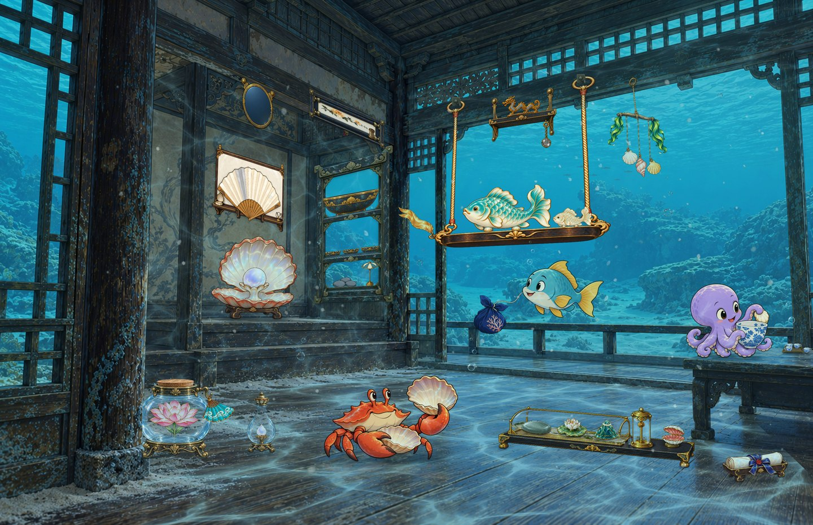
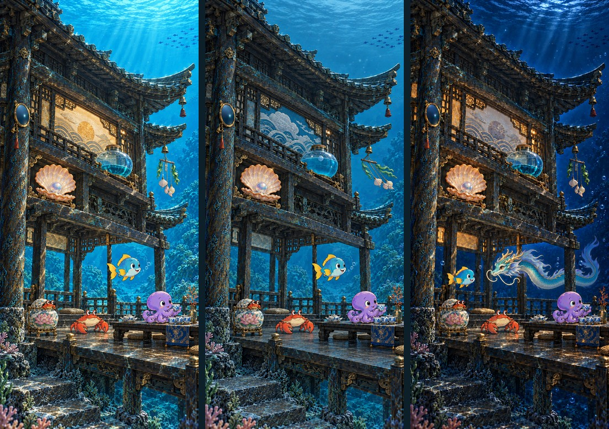

# Sunken Teahouse · Keepers of Finds

The Teahouse is a small inhabited world on the seabed. Its residents collect recovered objects, go about their activities and respond to events. Weather, time and game events influence life in this world.

## Data as artistic material

A theme translates data into expressive cues: light, colour, shape, an object's state or a character's action. Weather may find expression in the house and its furnishings. A game result may become part of an activity or a small change in daily life.

This translation preserves the character of the place. The artist chooses how to express a state and prepares its variants. Theme rules connect them to exact inputs. A measurement retains its meaning even when another screen uses a different artistic expression.

## A world with its own rules

The interior and the water outside share one underwater environment. Objects have weight and supports, hanging pieces have attachments, and lighting follows the architecture. State changes preserve these spatial relationships.

Photographic house materials coexist with drawn inhabitants. Their visual difference is intentional. Shared lighting, contact shadows, water depth and correct occlusion make them part of one scene. Cultural motifs provide a coherent language of shapes and materials, informed by research and artistic interpretation.

## Life between events

Meaningful changes affect the main scene. When its state remains stable, small household activities suggest continuing life. Combinations of prepared variants create variety from a limited artwork set.

Each frame remains a complete illustration selected through data and rules. The [dynamic theme specification](dynamic-wallpapers.md) describes base and household states precisely.

## One world, different screens

The desktop composition explores the interior's width and relationships among its parts. The phone foundation uses the pavilion's height and distributes activity vertically. They share a world while staging their frames independently.

The phone has an artistic foundation; production layer export and an installable theme remain a separate stage.

Readability guides composition. A new screen sometimes needs its own story or another viewpoint on the setting. In other cases, the same action can be recomposed through placement, scale and open space. The [wallpaper overview](wallpapers.md) explains both approaches.

Wallpaper is reviewed together with a device's clocks, notifications and icons. Their placement affects open areas and the size of the scene's main elements.

## From artwork to a frame

Prepared images form layers. Rules select their membership, order and opacity for one device. The server composes and publishes the frame together with its build description. Artistic work happens during theme preparation; routine updates use prepared materials.

See [composition, depth and light](composition.md), [theme rules](dynamic-wallpapers.md) and [ready-frame delivery](dynamic-api.md).

Reading order: [Contents](../../README.en.md) · Previous: [Site and game visual identity](visual-identity.md) · Next: [Teahouse composition, depth and lighting](composition.md)
