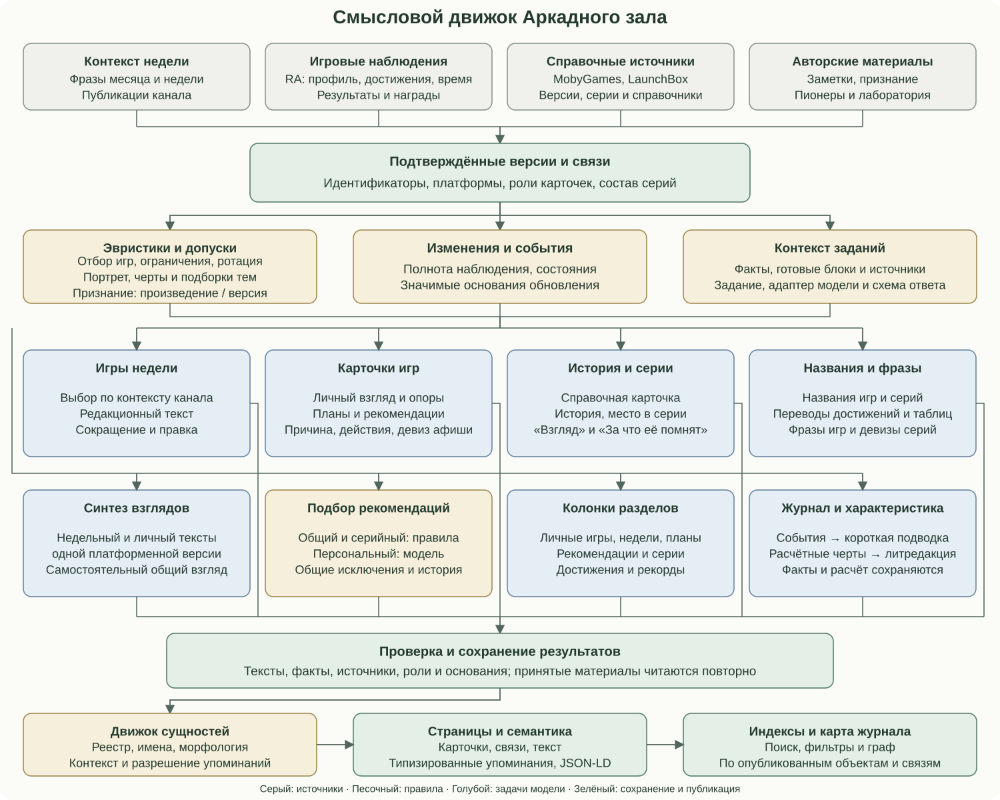
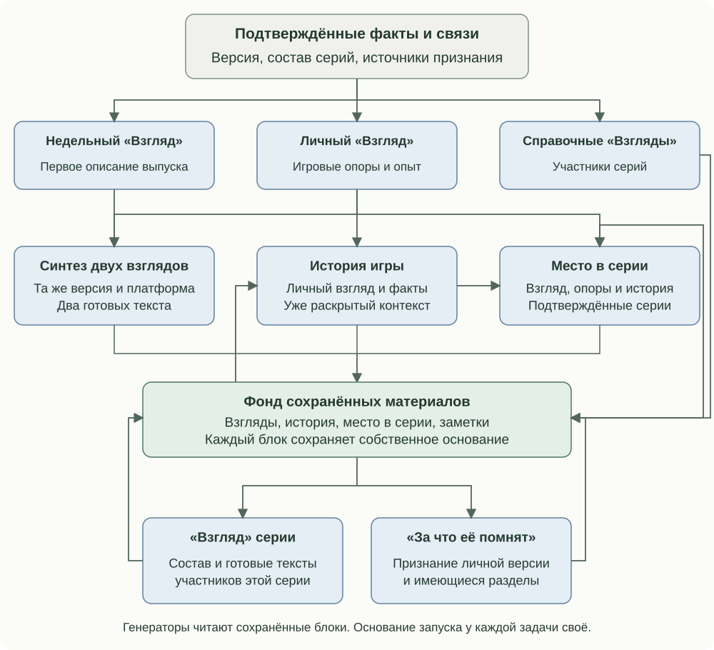
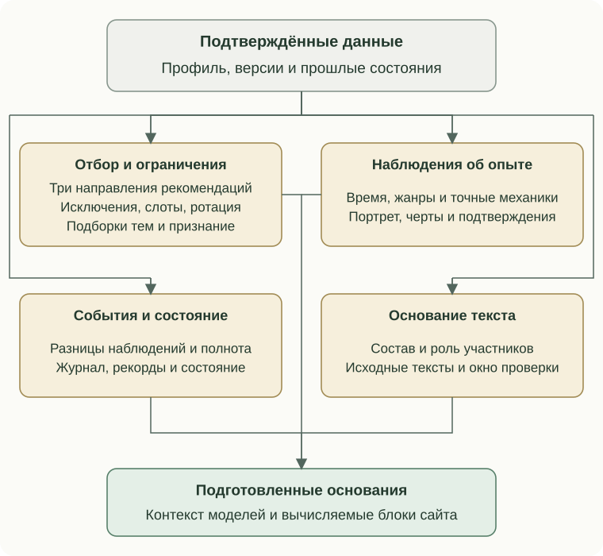
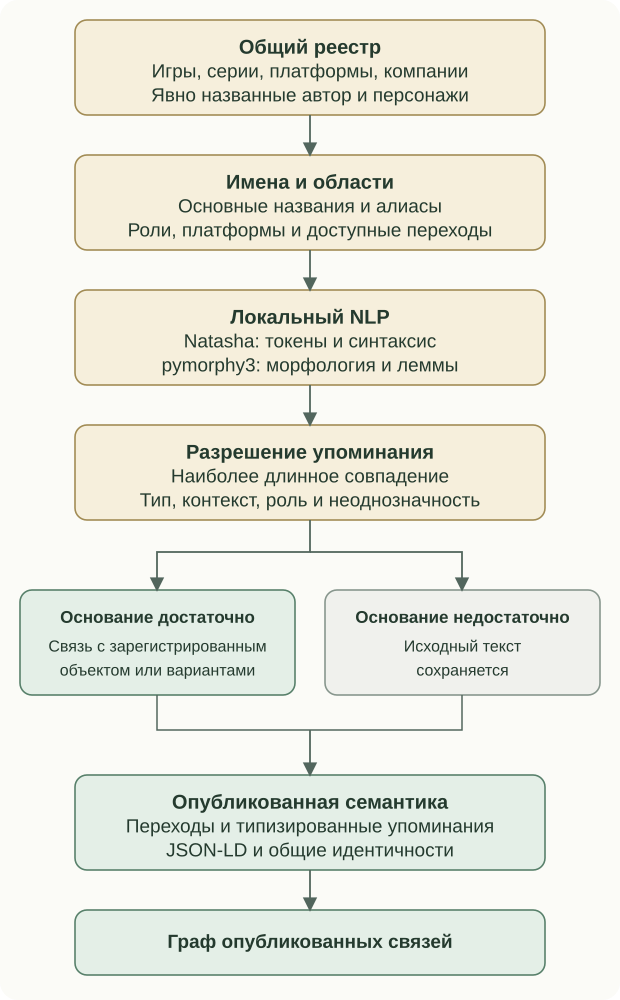

# Смысловой движок

В Аркадном зале работают вместе алгоритмы сопоставления, эвристики, редакционные генераторы и локальный движок сущностей. Модель получает подготовленный вопрос и контекст. Правила определяют допустимые данные, основание запуска и место результата в каталоге.

## Полная карта взаимодействия

На карте показаны источники, общая подготовка данных, все семейства смысловых генераторов, сохранение результатов и публикация. Внутри блоков перечислены отдельные задачи. Детальные зависимости и правила обновления раскрыты ниже.



Общий цикл связывает новые наблюдения с уже существующими материалами. Тексты могут использовать сохранённые блоки других задач: первое знакомство становится входом синтеза, истории игр входят в контекст серии, а подтверждённое признание даёт основание отдельному редакционному разделу.

## Контекст между текстовыми блоками



Связь контекста означает чтение подготовленного материала. Каждый генератор сохраняет свой результат и проверяет собственное основание запуска. История игры и серийный контекст могут видеть ранее подготовленные тексты серии; очередной «Взгляд» серии получает доступные тексты её участников.

## Эвристики и вычисляемый смысл



| Механизм | Что получает | Что определяет |
| --- | --- | --- |
| Сопоставление версий | RA ID, платформу, подтверждённые внешние ID и алиасы | Общую версию, роли её карточек, допустимые связи и исключения |
| Отбор личного опыта | Сохранённый профиль, время и полученные достижения | Игры для личной колонки; исходные пороги — больше 20 минут и не меньше трёх достижений |
| Общие рекомендации | Профиль, привычные платформы, составы достижений RA | Кандидатов по интересу сообщества и редкости набора; редкость учитывается отдельно от сложности |
| Рекомендации из серий | Подтверждённые серии, время и очки в сыгранных играх | Свободные игры знакомых серий; занятые слоты учитываются при распределении |
| Допуск к персональному подбору | Каталог RA, уже сыгранное, планы, текущие и архивные рекомендации, другие подборки | Допустимый набор кандидатов и поведенческий контекст для модели |
| Ротация | Срок присутствия игры и история отбора | Освобождение слотов по правилам возраста и интервала; переходы в сыгранное и планы учитываются отдельно |
| Аналитика опыта | Подтверждённые версии, роли, время, прогресс, серии, рекорды и события | Сводки, пересечения разделов, временные ряды, игровой портрет |
| Игровой портрет | Время, источники жанров и конкретных механик, объединение изданий | Взвешенные наблюдения об интересах; вес времени логарифмический, покрытие сведениями проверяется отдельно |
| Характеристика игрока | Результаты, серии, редкость, режимы прохождения и подтверждённые примеры | Черты с объяснимыми основаниями и расчётные фразы |
| Выделение событий | Предыдущее и текущее подтверждённые состояния | Новые игры, планы, рекомендации, достижения, награды, изменения результатов и мест |
| Состояние игрового автомата | Набор событий, полноту источников, дату сбора и календарную границу | Основное состояние и независимые признаки; дневное удержание учитывает выход недельного выпуска |
| Основание пересмотра | Сохранённые входы задачи, состав серии, роли участников | Решение о подготовке конкретного текста и объяснение причины |

У рекомендаций три самостоятельных направления: общий алгоритмический отбор, игры знакомых серий и персональный подбор моделью. Они имеют общие исключения и сохраняемую историю. Расчётная характеристика игрока существует отдельно от персонального отбора и сама по себе в его вход не подставляется.

## Конкретные правила выбора

Три направления рекомендаций имеют по пять слотов. Сохранённые подходящие записи удерживаются, новые кандидаты занимают свободные места. Общие исключения связывают личные игры, планы, недельные выпуски, другие подборки и историю рекомендаций через подтверждённые идентичности.

### Общий алгоритмический отбор

Пул начинается с отбора до трёх ведущих платформ профиля. Для широкого просмотра каталога используется воспроизводимый порядок по хешу профиля и RA ID. Порядок ответа каталога сам по себе оценкой популярности не считается.

Подходящий кандидат имеет корректный ID и платформу, минимум три достижения и не меньше 30 участников. Неофициальные записи и занятые игры исключаются. Редкость полного набора определяется отношением суммарных TrueRatio к обычным очкам достижений.

Базовый рейтинг складывается из популярности, соответствия ориентиру редкости и близости платформы:

```text
score = 0.55 * popularity + 0.25 * rarity_fit + 0.20 * platform_affinity
```

Популярность нормализуется через `log(1 + players)`. Ориентир редкости берётся из профиля и ограничивается диапазоном 1.5–3.5; при отсутствии используется 2.3. Соответствие ориентиру задаётся широкой гауссовой кривой с параметром 1.3. Жанровые сведения дают мягкую добавку до 0.1; повторение уже выбранных жанров получает небольшой штраф 0.03 за наибольшее совпавшее число.

Предпочтение разнообразию допускает сначала до двух игр одной платформы. Если остаются свободные слоты, они заполняются следующими допустимыми кандидатами независимо от этой мягкой границы. Значение редкости описывает распространённость результата, а не сложность игры.

### Отбор из знакомых серий

Кандидаты происходят из подтверждённых серий сыгранных игр. Для каждой серии складываются известное время и полученные очки её уникальных личных участников. Уже занятые, сыгранные и запланированные объекты учитываются в исключениях.

Следующая серия определяется прежде всего отношением накопленного времени к числу занятых ею слотов плюс один. При равенстве используется аналогичное отношение очков. Внутри выбранной серии предпочтение получает наиболее ранний доступный выпуск, затем меньший RA ID. Готовые подходящие слоты удерживаются.

### Персональный подбор моделью

Контекст — до десяти игр с воспроизводимой оценкой вовлечённости. Четыре составляющие имеют веса:

| Сигнал | Вес | Основание |
| --- | --- | --- |
| Время | 0.30 | Логарифм часов, нормализованный по 95-му процентилю времени профиля, с ограничением сверху |
| Достижения | 0.25 | Доля полученных достижений своей версии |
| Подтверждённый результат | 0.25 | Распространённость достигнутого статуса, прогресса или места в соответствующей популяции |
| Редкие полученные достижения | 0.20 | Сумма весов `1 - share` для достижений с долей получения меньше 20%, насыщение после трёх единиц суммы |

Модель получает весь доступный допустимый каталог RA на платформах общего отбора после исключений. Количество ответа равно числу свободных слотов с учётом доступных кандидатов. Квоты по жанрам, сериям и платформам в задании отсутствуют; новые интересы могут расширять исходный набор.

Ответ проверяется по RA ID: только переданные кандидаты, без повторов, с причиной рекомендации и действием для первого знакомства. Названия, платформы и ссылки берутся из каталога. Принятый отбор и его основания сохраняются до дальнейшей подготовки карточек.

### Ротация рекомендаций

Параметры по умолчанию — возраст больше 30 суток, интервал семь суток, одна наиболее старая подходящая запись за интервал. Это единая возрастная ротация трёх направлений. Переход в сыгранное или планы освобождает слот по своему основанию. Архив и исходная дата попадания сохраняются; повторная обработка той же игры её срок заново не отсчитывает.

### Рамки недельного выбора

Допустимые платформы и годы поступают из общего набора отбора. Контекст выпуска включает фразы месяца и недели и публикации канала. Повторы проверяются по существующим готовым MD-выпускам в настроенном временном окне; значение окна может охватывать всю историю. Сохранённый готовый выпуск переиспользуется, явная пересборка имеет отдельный режим.

### Подборки тем и признание

Подборка темы ограничена десятью играми. Сначала обрабатываются явно записанные позиции в порядке пакета, затем дополняющие правила платформ и серий. Динамические позиции сортируются по нормализованному названию, платформе и ключу. Дубли одной версии объединяются.

Совпадение позиции проверяется по подтверждённому ID или названию с платформой. Неразрешённая позиция остаётся справочной записью «Вне каталога»; при заданном RA ID у неё есть внешний переход. Лабораторная игра задаётся отдельным ID и включается при наличии опубликованных страниц описания и запуска. Ошибка необязательной подборки обрабатывается отдельно от полноты обязательных ресурсов темы.

Признание присоединяется по записям источника и объявленной области действия: произведение, платформа или конкретная версия. Недельный выпуск, личная игра и справочная карточка сохраняют роли. Текст «За что её помнят» готовится для подходящей личной версии; исторические сведения «Пионеров» и связь с лабораторией имеют собственные идентификаторы.

## Пороговые правила игрового портрета

Портрет использует подтверждённые личные издания со временем больше 60 секунд. Короткие запуски, неизвестное время и неподтверждённые сведения учитываются отдельно. Версии одного произведения объединяются перед логарифмическим взвешиванием; отображаемое время остаётся фактическим.

| Наблюдение | Основание |
| --- | --- |
| Ведущая платформа | Не меньше трёх разных произведений и 50% известного времени |
| Ведущая серия | Не меньше двух произведений и 25% известного времени |
| Устойчивая механика | Не меньше трёх произведений в каждом из двух срезов; одна ведущая механика сохраняется и вне доминирующей серии, с весом от 35% в обоих срезах |
| Редкое достижение | Подтверждённая доля получения не больше 5% |
| Незаконченный эпизод | Подходящая незавершённая игра; предпочтение самостоятельному эпизоду вне ведущей серии |
| Отдельная игра | Резервное наблюдение, когда более общие основания ещё не сложились |

В наблюдениях показываются до пяти карточек. Для кратких подписей интересов выбираются до двух направлений: жанры профиля, затем подтверждённые конкретные механики, затем общие жанры. Требуется покрытие сведениями не меньше 60% суммарного веса, минимум три произведения для направления и доля веса от 20%.

## Правила расчётной характеристики

| Черта | Условия |
| --- | --- |
| Хардкорщик | От десяти достижений; режим известен минимум для 80% полученных достижений; не меньше трёх разных игр и двух прохождений в Hardcore; доля Hardcore от 80% |
| Свой на платформе | Минимум три произведения и 20% сыгранной полки на платформе |
| Знаток платформы | Дополнительно минимум три завершённых произведения и 60% завершения этой платформенной полки |
| Свой человек в серии | Минимум три знакомых произведения и 60% видимого состава серии в нашем каталоге |
| Мастер серии | Знакомы от 80%, завершены от 60% видимого состава; пересекающиеся исходные группы объединяются по сходству полного состава от 60% |
| Исследователь | От 40% полки вне ведущей платформы; три платформы с долей от 5% и три десятилетия от 10%; в каждой группе минимум две игры |
| Редкий трофей | Получено достижение с распространённостью до 5% при базе от 1000 игроков |
| Охотник за редкостями | Минимум три таких достижения в двух разных произведениях |
| Крепкий орешек | Полные согласованные данные сообщества минимум по трём произведениям; медианный подъём прогресса от 1.5 относительно среднего и минимум три подтверждающих игры |
| На доске почёта | Не меньше трёх результатов в двух произведениях, в первых 10% таблиц с базой от 100 участников |
| Ещё один заход | Подтверждённая игра после прохождения в два разных дня с разницей от семи суток; каждое наблюдение содержит больше 60 секунд игры |

Покрытие серии относится к составу в каталоге. Основное издание произведения выбирается по времени игры, а измерения по разным портам сохраняют свою идентичность. Сравнение с сообществом использует полный согласованный набор достижений и одну известную популяцию от 100 игроков.

Блоки «Характер», «Сильная сторона» и «Особая примета» выбираются правилами приоритета подтверждённых черт. Для основного блока приоритет имеют Hardcore, аркады, другие платформы и исследование; при отсутствии этих оснований берётся первая доступная черта. Для сильной стороны порядок — серия, редкость, сравнительный прогресс, соревнование. Исследовательская черта может стать особой приметой, когда она ещё не использована в основных блоках.

Незаконченный эпизод добавляется при наличии минимум трёх завершённых произведений: от часа игры и меньше четверти достижений в конкретной незавершённой игре. Из подходящих эпизодов выбирается наиболее длительный. Литературная редакция получает готовые блоки при наличии как минимум двух черт.

Порог редкости зависит от задачи. Для состояния автомата это не больше 10% при базе от 100 игроков, для сигнала персонального отбора — меньше 20%, для наблюдения портрета — до 5%, для редкой черты — до 5% при базе от 1000 игроков. Каждая величина сохраняет своё назначение и популяцию.

## Игры недели и карточки

| Задача | Вход | Сохранённый результат |
| --- | --- | --- |
| Подбор игры недели | Фразы месяца и недели, публикации недели, исторические и платформенные рамки, исключения повторов | Выбранная версия, игровые опоры и смысловая связь с темой выпуска |
| Редакционный текст выпуска | Выбранная игра, смысловая связь, ограничения объёма | Текст, ракурс, использованные игровые опоры и замысел сцены |
| Сокращение и редакционная правка выпуска | Готовый текст и конкретное ограничение или замечание | Проверенная редакция выпуска |
| Личная карточка | Версия игры, справочные сведения, доступные и полученные достижения | «Взгляд» и игровые опоры |
| Карточка «На будущее» | Версия и сведения о возможностях игры | Текст знакомства и игровые опоры |
| Карточка рекомендации | Выбранная версия и её сведения | Редакционный текст и игровые опоры |
| Дополнение игровых опор | Подтверждённая версия и сведения о ней | Отсутствующие опоры без переписывания готового «Взгляда» |
| Блоки рекомендации | Основание отбора, готовый «Взгляд», механики, сохранённая причина | «Почему рекомендована», «Что попробовать», девиз афиши |
| Блоки планов | Готовый «Взгляд», механики и сведения о версии | «Что попробовать» |
| Девиз афиши отдельно | Готовые тексты и сохранённая причина рекомендации | Недостающая авторская строка афиши |
| Совместный «Взгляд» | Недельный и личный тексты одной версии | Самостоятельный синтез двух взглядов |

Подбор игры недели использует контекст канала и историю выпусков. Рекомендации решают другую задачу: предлагают игры из допустимого каталога по своим основаниям. Текст модели сохраняется после проверки формы и содержательных требований задачи.

## Серии, история и признание

| Задача | Вход | Сохранённый результат |
| --- | --- | --- |
| Справочное описание участника серии | Версия игры, её сведения и подтверждённые группы | Короткий «Взгляд» справочной карточки |
| «Место в истории» | Версия, готовый «Взгляд», тексты её серий и уже раскрытый контекст | Исторический раздел с источниками |
| «Место в серии» | Личный «Взгляд», игровые опоры, история, подтверждённые серии и их готовые тексты | Единый раздел о месте этой версии в её сериях |
| «Взгляд» конкретной серии | Подтверждённый состав и подготовленные тексты игр | История и значение серии с источниками |
| «За что её помнят» | Конкретная личная версия, подтверждённые списки признания и имеющиеся разделы | Отдельный текст о признании этой игры с источниками |

У этих задач есть взаимный контекст, но отдельные результаты и правила запуска. Например, история игры видит уже изложенное в обзоре серии, а «Место в серии» получает историю игры. Входом служат сохранённые материалы, доступные в текущем цикле. Это позволяет продолжать рассказ без обязательного одновременного пересоздания всех связанных текстов.

## Названия, переводы и подлинные фразы

| Задача | Что устанавливает | Как используется |
| --- | --- | --- |
| Русское название игры | Подтверждённое название конкретной версии | Отображение, поиск и реестр имён |
| Русское название серии | Подтверждённое употребление названия серии | Заголовок серии и её алиасы |
| Перевод достижений | Русские названия и описания с сохранением ID | Карточки, достижения и контекст личного опыта |
| Перевод таблиц рекордов | Русские названия и условия конкретных таблиц | Раздел рекордов и редакционный контекст соревнований |
| Подлинная фраза игры | Найденную и проверенную исходную фразу, источник и перевод | Отдельный фактический блок карточки |
| Подлинный девиз серии | Подтверждённую фразу серии и источник | Страница конкретной серии |
| Перевод исходной фразы | Русское прочтение уже установленного оригинала | Пара оригинал / перевод |
| Проверка и восстановление фразы | Источник прежней записи и корректность её перевода | Явное обслуживание сохранённого материала |

Подлинная фраза игры и авторский девиз рекомендательной афиши имеют разное происхождение. Первая устанавливается по источнику, вторая пишется как редакционный материал.

## Колонки разделов

Каждая колонка получает собственный набор данных. Готовые «Взгляды» и игровые опоры используются там, где они входят в задачу.

| Колонка | Вход | Результат |
| --- | --- | --- |
| Личные игры | Отобранный игровой опыт, полученные достижения и контекст серий | Общий «Взгляд» на личную полку |
| Игры недели | Видимые недельные выпуски, их тексты и основания выбора | Вступление к недельному архиву |
| Рекомендации | Текущая витрина, сохранённые «Взгляды» и опоры | Колонка о выборе приключения |
| «На будущее» | Активные планы, сохранённые тексты и опоры | Колонка о предстоящем знакомстве |
| Серии | Названия серий и известный состав | Вступление к общему разделу серий |
| Достижения | Профиль и подтверждённые полученные достижения | Колонка о личных игровых испытаниях |
| Рекорды | Личные результаты, условия таблиц, места и число участников | Колонка о характере соревнований |

## Журнал и характеристика

Фактическая часть автоматического журнала собирается из обнаруженных изменений. Модель получает тип события, идентификаторы и готовые факты, затем пишет короткую подводку. Список событий сохраняет собственное основание и публикуется также при недоступности подводки.

Характеристика игрока сначала вычисляется правилами: черта, объяснение и подтверждающие игры. Литературный этап получает эти готовые утверждения и редактирует формулировки. Состояние попытки сохраняется до вызова модели. Расчётный текст остаётся пригодным к публикации при неудаче литературной редакции.

## Собственный движок сущностей



Реестр включает игры, серии, платформы и компании, присутствующие в собираемом каталоге. Сведения страницы «О проекте» добавляют явно названного автора, его альтер эго, персонажей и контакты. Для одной версии выбирается приоритетная карточка, а известные названия остальных её представлений остаются доступными для поиска упоминаний.

Локальная обработка использует сегментацию и синтаксический анализ Natasha и морфологию pymorphy3. Названия разбираются на токены и леммы; индекс последовательностей находит наиболее длинное зарегистрированное совпадение. Контекст помогает различить игру, серию, платформу, разработчика и издателя.

| Правило разрешения | Поведение |
| --- | --- |
| Обычное русское слово совпало с названием | Учитываются оформление и соседнее обозначение типа сущности |
| Короткое название оказалось частью более длинного имени | Самостоятельное упоминание требует своего основания |
| Игра и серия называются одинаково | Явный контекст задаёт тип; без него приоритет у игры |
| Осталось несколько разных типов или неоднозначных объектов | Ссылка пропускается |
| Одно название относится к нескольким версиям игры | Подтверждённые варианты остаются вариантами выбора читателя |
| Платформа выражена прилагательным | Проверяется связь с версией, портом или зарегистрированной игрой этой платформы |
| Компания выступает разработчиком или издателем | Синтаксический контекст выбирает соответствующий фильтр |
| Упоминание ведёт на текущую сущность | Самоссылка пропускается |

Автоматическая обработка действует в пригодной прозе. Явные авторские ссылки, код, элементы управления и исключённые участки разметки сохраняются. Движок добавляет переходы к существующим объектам; связь текста с историческим фактом подтверждается отдельными источниками.

## Публикация, разметка и граф

Один реестр идентичностей используется в перелинковке и семантическом выводе. Включение автоматических ссылок настраивается отдельно от использования реестра в структурированных данных. Адаптеры добавляют типы сущностей, упоминания и структурированные данные к готовым страницам. Сведения об авторе и контактах берутся из явных записей.

Карта журнала строится по опубликованным HTML-страницам, внутренним переходам и объявленным отношениям. Она показывает уже существующие связи каталога. Поисковые индексы, фильтры и структурированные метаданные используют подготовленные сведения и правила представления.

## Управление циклом

У каждой задачи есть собственный допуск: настройки, подходящие данные, отсутствие результата или значимое изменение его основания. Плановый запуск объединяет сбор профиля, подготовку недостающих карточек, отбор рекомендаций, синтез, работу с сериями, редакционные блоки и публикацию. Ночной профильный цикл отдельно обновляет личные наблюдения и совместные тексты уже опубликованных недельных выпусков.

Смена модели, размещения файлов или редакции задания сама по себе сохраняет готовые материалы там, где основание задачи определено предметными данными. Политики различаются по задачам; точные причины пересмотра приведены в [таблице обновлений](editorial-feedback.md).

Порядок чтения: [Оглавление](../README.md) · Назад: [Движки и контуры Аркадного зала](site-engines.md) · Далее: [Когда обновляются материалы](editorial-feedback.md)
