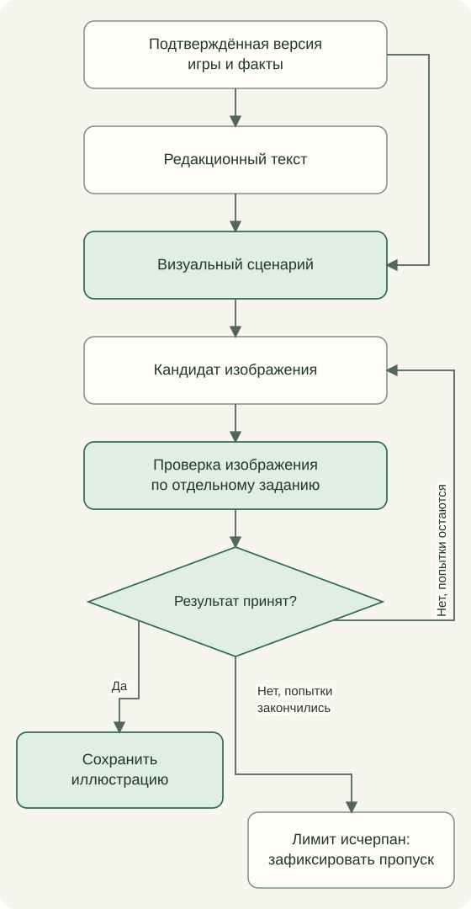

# От данных к тексту и иллюстрации

Рабочая цепочка состоит из правил отбора, подготовленного контекста, промпта, структурированного ответа, проверки и сохранённого результата. Один и тот же промпт с другим набором фактов может дать другой смысл. Одно и то же событие не обязано менять все материалы.

## Разные редакционные вопросы

| Задача | На какой вопрос отвечает |
| --- | --- |
| Личная карточка | Как объяснить игру в контексте имеющихся данных о прохождении? |
| Карточка «На будущее» | Что попробовать в ещё не пройденной игре? |
| Рекомендация | Почему эту игру стоит попробовать следующей? |
| Синтез взглядов | Как совместить первое описание и последующее знакомство с той же версией? |
| Место игры в серии | Чем эта версия отличается на фоне подтверждённого состава серии? |
| Обзор серии | Как связаны участники и их развитие? |
| Историческое признание | За какие свойства игра осталась заметна в истории? |

Это разделение намерений. Повторяющееся требование «развить мысль» не заменяет постановку разных вопросов.

## Карточка и иллюстрация

Проверка рассматривает назначение афиши, признаки конкретной игры, персонажей и композицию. Оценка моделью не является гарантией правильной анатомии или исторической точности; критерии проверки заданы отдельным промптом.

У трёх рубрик разные художественные задачи: рекламная рисовка эпохи игры в личных афишах, знакомство с миром игры в планах, современная зрелищная афиша в рекомендациях. Постановка сцены связывает этот художественный язык с конкретной игрой.

## Источники и ответы

Для исследовательских задач в контекст передаются уже известные сведения и ограничения поиска. Источники сохраняются вместе с результатом, а ответ проходит проверку формы и содержания, предусмотренную задачей.

Локальный build читает сохранённые результаты. Получение новых внешних сведений и платная генерация имеют самостоятельные этапы. Это позволяет понять, какой материал опубликован и на каком основании он возник.

## Промпты в работе каталога

В [оглавлении промптов](../prompts/README.md) задания сгруппированы по назначению. Недельный выпуск начинается с выбора игры и смысловой связи с темами канала. Далее следуют личные карточки, планы и рекомендации; внутри каждой цепочки виден порядок подготовки текста и медиа. Синтез, история, признание, поиск названий, переводы, колонки и журнал образуют самостоятельные группы задач.

У каждого задания указаны вход, результат и следующий шаг. Полный текст приведён в PDF и в отдельном Markdown-файле.

В визуальных заданиях участвуют Гремлин и Лиса — персонажи каталога. Их узнаваемость задают изображения-референсы, передаваемые модели вместе с заданием. 

Общий адаптер передаёт модели задание и подготовленный контекст. Валидатор проверяет ответ, затем результат сохраняется для публикации. Точный вход одной текстовой задачи приведён в [форматах данных](contracts.md), а полный состав смысловых ветвей — в [схеме движка](meaning-system.md).

Порядок чтения: [Оглавление](../README.md) · Назад: [Когда обновляются материалы](editorial-feedback.md) · Далее: [Навигация, доступность и метаданные](accessibility.md)
