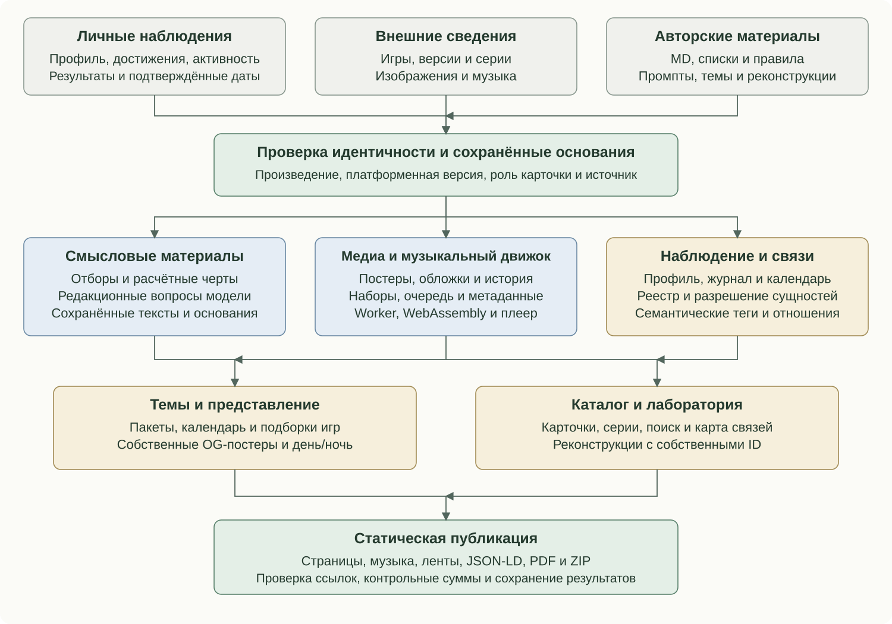

# Движки и контуры Аркадного зала

Аркадный зал связывает игровой опыт, редакционные материалы и работающие интерактивные компоненты. Смысловые генераторы - один из его контуров. Музыка, медиа, темы, лаборатория, поиск и публикация используют собственные модели данных и условия обновления.

## Полная карта компонентов

Схема показывает зависимости компонентов. Получение внешних данных, подготовка редакционных материалов, локальная сборка и действия читателя выполняются в своих режимах. Подробные связи текстовых задач приведены в разделе о смысловом движке.

## Данные, версии и источники

Личный профиль поступает из RetroAchievements: игры, полученные достижения, режимы, прохождения и активность. Справочные сведения об издании, разработчиках, жанрах и сериях обогащаются через настроенные источники, включая MobyGames и локальные данные LaunchBox. Поддержка IGDB существует в коде; включение каждого источника задаёт рабочая конфигурация.

У источников разные полномочия. Наличие достижения подтверждается профилем, состав серии - соответствующими связями, а локальный справочник задаёт нормализованное имя платформы. Произведение, платформенная версия и карточка рубрики сохраняют отдельные идентичности. Названия для читательского поиска могут быть шире набора признаков, используемых для связывания записей.

Нормализация охватывает платформы, компании, русские названия, жанры, игровые режимы и точность дат. Время получения сведений отделяется от даты самого события. Неполный ответ источника сохраняет признак неполноты и позволяет продолжить работу с подтверждёнными материалами.

## Личный опыт, рекомендации и серии

Расчётные правила превращают время, достижения и результаты в признаки вовлечённости, игровой портрет, характеристику и рекомендации. Три потока рекомендаций используют собственные основания: общий отбор, знакомые серии и персональный выбор модели. Их действующие формулы и ограничения описаны отдельно.

Серии объединяют подтверждённые платформенные версии и справочные карточки. Согласование идентичностей удерживает связи при известных переименованиях. Изменение состава или личного статуса участников даёт основание проверить текст серии. У конкретной личной карточки собственное основание для раздела «Место в серии».

Признание связывает игры с редакционными историческими списками и сохраняет область действия записи: произведение, платформа или версия. «Пионеры» объединяют исторические объекты с собственными идентификаторами; связь с реконструкцией лаборатории задаётся отдельно.

## Музыкальный движок: получение и библиотека

Музыкальный контур включает поиск подходящего набора, очередь получения, разбор файлов, локальное хранение, описание треков, публикацию и браузерное воспроизведение. Набор связывается с карточкой по игровой идентичности и платформе. Дополнительные названия и регион помогают сопоставлению; числовые части названий сохраняются при проверке продолжений.

Источник может быть указан явно. Автоматические адаптеры работают с SMS Power!, Zophar's Domain, Video Game Music Preservation Foundation и Games Database. Порядок провайдеров и доступные платформы задаются настройками. Для поиска оригинальных музыкальных файлов и готовых аудиозаписей существуют отдельные попытки и результаты.

Задания и история попыток хранятся в SQLite. Очередь учитывает лимит времени и запросов, отложенные повторы и ограничения провайдера. Готовый набор сохраняется во время неудачных новых попыток. Для доступной записи может отдельно планироваться поиск оригинальных музыкальных файлов. Удалённая или отключённая карточка перестаёт поддерживать прежнее задание загрузки.

Поддерживаются оригинальные игровые форматы NSF, NSFE, GBS, HES, SPC, VGM, VGZ, AY и SAP, а также MP3, OGG, Opus, WAV, M4A и FLAC. Возможность воспроизведения конкретной записи зависит и от браузера. Разбор M3U сохраняет номер подкомпозиции отдельно от порядка трека. Метаданные файлов и плейлистов могут задавать название, длительность, вступление, цикл и затухание.

Неизвестная длительность остаётся неизвестной в данных и интерфейсе. Для оригинального игрового формата задаётся техническое время воспроизведения и затухания; оно позволяет завершить трек, но не выдаётся за подтверждённую длительность композиции.

Содержимое хранится в локальных файлах с проверяемыми описаниями. В обычной сборке публикуются только готовые наборы. Проверяются идентичность, платформа, треклист и наличие файлов ожидаемого размера. Неполный набор не создаёт работающую на вид панель. Получение музыки относится к отдельному плановому или явному этапу.

## Музыкальный движок: браузерный плеер

Карточки и музыкальная библиотека страницы Гремлина используют общий для сайта объект управления воспроизведением. Он хранит выбранный набор, индекс трека, состояние, позицию и громкость. Поиск в библиотеке работает по локальному индексу наборов и треков; полные описания и музыкальные файлы загружаются отдельно.

Для обычной аудиозаписи используется браузерный Audio. Для игровых форматов декодер Game Music Emu собран в WebAssembly и запускается в Worker. Подготовленные PCM-блоки поступают в AudioWorklet. Для локального HTTP-просмотра предусмотрен транспорт на планируемых AudioBuffer-блоках с ограниченной очередью.

Воспроизведение учитывает паузу, возобновление, переключение композиции и затухание. Счётчик поколения запроса отделяет актуальное действие от завершения прежней загрузки. Повторное нажатие во время загрузки того же трека удерживает один активный запуск. При переключении освобождаются ресурсы предыдущего транспорта; громкость сохраняется локально в браузере.

Музыкальная семантика дополняет общий JSON-LD узлами MusicPlaylist и MusicRecording, связанными с канонической VideoGame. Известная длительность и кредит исполнителя передаются по сохранённым данным. Название игры само по себе не доказывает личность композитора, региональную идентичность или лицензию музыки.

На странице источников публикуется происхождение готовых наборов. Для компонента Game Music Emu сайт также предоставляет лицензию, соответствующие исходники и сведения о сборке. У декодера, музыкальных файлов и авторских технических материалов собственные условия использования.

## Визуальные материалы и медиаархив

Редакционный текст и игровые опоры дают контекст отдельному конвейеру иллюстрации. Постановка сцены, создание кандидата и проверка имеют свои сохранённые результаты. Проверка ограничивает число попыток; неудачная замена удерживает пригодный предыдущий материал.

Подбор обложек, титульных экранов и скриншотов проверяет пригодность кандидатов и сохраняет сведения об источниках. Пользовательские переопределения, собственные постеры и найденные материалы имеют определённые роли. Галерея может показывать историю постеров; появление нового изображения не стирает прежний опубликованный вариант.

Медиаархив сопоставляет исходные и опубликованные файлы по SHA-256. В MD добавляется управляемый блок со ссылками на готовые материалы. Остальной текст и YAML сохраняются. Одинаковые изображения переиспользуются; для исходных материалов пакета темы может сохраняться ссылка на уже существующий файл.

## Темы, календарь оформления и OpenGraph

Пакет темы содержит описание, календарные условия, оформление и необходимые ассеты. Подборка, доступная через кнопку «О теме», связывает до десяти игр с каталогом, внешними сведениями и лабораторией. Пустая подборка и неполный обязательный комплект оформления - разные состояния.

Перед включением пакета проверяются обязательные файлы. Неполный пакет целиком уступает место следующему допустимому варианту. Календарь выбирает событие, сезон и базовое оформление по установленным приоритетам. Скрытый пакет может оставаться доступным для предусмотренного просмотра.

Дневные и ночные варианты изображения имеют собственные имена и ключи. Плановый переключатель OpenGraph меняет ссылки на подготовленные варианты без полной генерации каталога. Выбор оформления в браузере и превью, прочитанное роботом из HTML, проходят разными путями: для устойчивого превью конкретной темы предусмотрены подготовленные страницы со статическими метаданными.

Медиаплеер использует сведения о доступных темах и позволяет открыть страницу с выбранным оформлением. Общие стили и базовые ресурсы обеспечивают отображение при отсутствии специального варианта.

## Лаборатория

Лаборатория публикует работающие реконструкции ранних игр. Реестр задаёт собственный ID объекта, описание оригинала, источники, степень соответствия, страницу сведений и страницу запуска. Общая оболочка и ресурсы конкретной реконструкции образуют отдельные части пакета.

В каталоге, «Пионерах» и подборках тем используется явная связь с объектом лаборатории. RA ID для такой связи не требуется. Страницы лаборатории получают канонические адреса, OpenGraph и структурированные данные. Ресурсы запуска имеют собственные проверяемые версии. Описание схемы каталога не заменяет исследование исторического прибора и документацию конкретной реконструкции.

## Поиск, связи и семантика

Читательский поиск использует локальный MiniSearch и сохранённые названия, включая варианты написания. Фасеты строятся по тем же сведениям платформенной версии, которые показаны на карточке: жанр, компания, признание и режимы игроков. Этот поиск отделён от проверки идентичности записи.

Движок сущностей распознаёт допустимые упоминания через реестр имён, морфологию и синтаксический контекст. Роли и идентификаторы затем используются в ссылках и структурированных метаданных. Подробные правила разрешения неоднозначности описаны в разделе о сущностях.

Карта журнала извлекает связи из опубликованных страниц и объявленных отношений. Её браузерное представление использует Cytoscape. Такой граф отражает подготовленные материалы и переходы; для его построения не требуется повторное сочинение содержания карточек.

## Движок семантических тегов

Движок строит типизированное описание страницы, её материалов и отношений. Он разбирает подготовленный HTML: видимые заголовки, блоки текста, ссылки, изображения и объявленные роли. Реестр сущностей даёт общие идентичности. Поэтому видимая карточка и её машиночитаемое описание используют согласованное основание.

На уровне сайта создаются Organization и WebSite, на уровне страницы - WebPage или соответствующий тип раздела. Хлебные крошки формируют BreadcrumbList, списки - ItemList. Игра представлена как VideoGame, серия - как CreativeWorkSeries. Редакционный материал получает собственный узел BlogPosting, Review или CreativeWork, связанный с описываемой игрой и страницей публикации.

Изображения образуют отдельные ImageObject с ролью, адресом и известными размерами. Ссылки на источники входят в описание соответствующего материала. Музыкальный контур добавляет свои MusicPlaylist и MusicRecording с теми же идентификаторами игры. Лаборатория использует сведения о реконструкции и историческом оригинале.

Семантика автора и персонажей строится по явным объявлениям в MD страницы «О проекте». Дмитрий Малыхин представлен как автор, Гремлин - как заявленное альтер эго. Контакты размечаются по объявленным контактным строкам. Случайное имя в свободном тексте не устанавливает авторство или юридическую принадлежность объекта.

Параллельно добавляются microformats и атрибуты типизированных упоминаний. Разбор имён, HTML-аннотации и JSON-LD выполняют разные части одной цепочки. Якорь персонажа, ссылка из текста и идентификатор в графе сохраняют согласованную сущность.

Происхождение текста учитывается на уровне редакционного блока: тип участия ИИ, модель и при наличии контрольная сумма текста. Привязка к версии позволяет отличить сохранённое подтверждение от последующей правки. Машинная маркировка происхождения и поле лицензии решают разные вопросы. Правовой статус изображения не выводится из признака AI, а лицензия собственного игрового текста не распространяется автоматически на всю страницу и сторонние материалы.

## Генераторы постеров OpenGraph

OpenGraph использует подготовленные изображения определённой страницы или рубрики. Для игровых карточек, серий и разделов существуют разные способы построения превью. Детерминированные компоновщики читают сохранённые изображения и факты; рисование новых сюжетных иллюстраций выполняется отдельным конвейером.

Постер серии собирается в журнальном формате 1200×630 из максимум трёх пригодных изображений подтверждённых участников. Собственные каталожные материалы получают приоритет; свободные позиции могут заполняться проверенными справочными обложками. Повторные представления одной игры учитываются при отборе, а заглушки провайдера и повреждённые файлы исключаются.

Компоновщик размещает изображения, название и служебные надписи по заданной геометрии. Шрифт закреплён в составе проекта. Размер и переносы подбираются по доступной области; полное название остаётся в HTML-метаданных и при исключительном сокращении надписи на самом постере.

Разделы используют собственные образы и описания. Краткое описание превью может извлекаться из подготовленной колонки; извлечение учитывает границы предложений. OG-изображение, заголовок и описание связываются с канонической страницей.

День, ночь и пакет темы образуют собственные варианты ресурсов. Проверяемое состояние хранит связь с подготовленным изображением; имена и ключи различают версии. Переключение готового варианта не запускает создание всей иллюстрации заново. Выбор изображения для социальной ссылки связан с медиаплеером и календарём оформления, сохраняя собственный статический HTML для робота превью.

## Журнал, календарь и внешняя публикация

Игровой журнал объединяет ручные заметки и сводки подтверждённых изменений. Детерминированные факты отделены от короткой редакционной подводки. Первый снимок задаёт основание сравнения, поэтому старый архив не превращается в перечень новых сегодняшних событий.

Календарь хранит собственные идентификаторы событий, источник даты и время наблюдения. Реальная дата получения достижения отличается от дня, когда каталог впервые заметил изменение. В интерфейсе и выгрузках эти основания сохраняют свои роли. Полнота данных и успешное завершение публикации влияют на фиксацию следующего состояния.

Сайт публикует ленты, карту сайта, канонические ссылки, OpenGraph, microformats и JSON-LD. Синхронизация внешнего календаря использует подготовленные события и настройки. Исходящие Webmention отправляются отдельной операцией со своим состоянием доставки; дорогостоящая сборка каталога не повторяет эту доставку.

## Сборка и открытая документация

Плановые режимы обновляют разрешённые источники и зависимые материалы. Обычная сборка читает сохранённые данные и готовит статические страницы. Явные команды позволяют заполнить пропуски или обновить отдельный материал в пределах выбранной задачи.

Контрольные суммы связывают результат с его основанием и проверяют фактические опубликованные байты. Повреждённые или потерянные производные файлы могут быть восстановлены. Блокировка записи, подготовка временных файлов и сохранение предыдущих пригодных материалов поддерживают продолжение работы после сбоя. Финальная проверка разметки и локальных ссылок входит в публикационный цикл.

Общая [документация](documentation.md) продолжает действующий публичный комплект. Страницы сайта, PDF, ZIP и GitHub используют одни Markdown. Обычная сборка переиспользует готовые экспорты; ошибка сохраняет прежнюю пригодную редакцию и не останавливает каталог. Приложения и реконструкции сохраняют собственные репозитории.

## Границы описания

В этом описании библиотечные компоненты названы рядом с собственными правилами и связями Аркадного зала. Их конкретные роли видны в [источниках и ресурсах](resources.md). Авторские задания опубликованы в [разделе промптов](authoring-prompts.md). Конфигурация сервера, ключи и рабочие базы состояния в публичный комплект не входят.

Порядок чтения: [Оглавление](../README.md) · Назад: [Устройство Аркадного зала](architecture.md) · Далее: [Смысловой движок](meaning-system.md)
