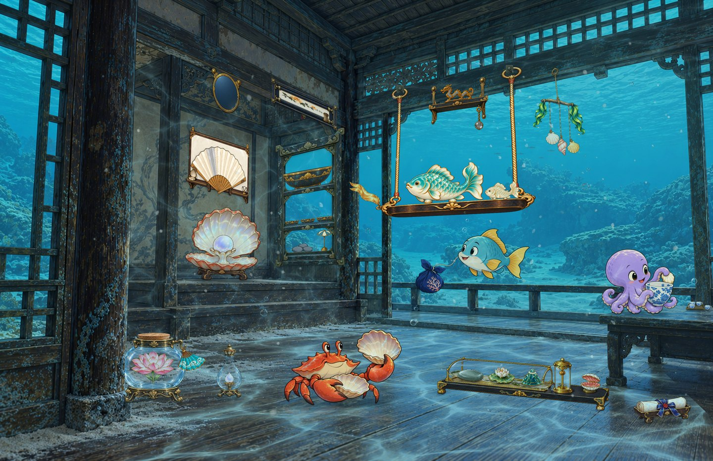
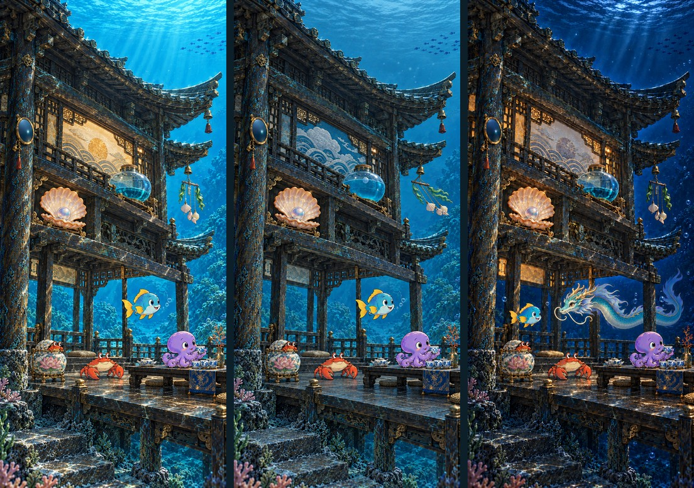

# Затонувшая чайная · Хранители находок

Чайная — небольшой обитаемый мир на морском дне. Её жители собирают найденные вещи, занимаются своими делами и откликаются на происходящее. Погода, время и игровые события влияют на жизнь этого мира.

## Данные как художественный материал

Тема переводит данные в выразительные признаки: свет, цвет, форму, состояние предмета или действие персонажа. Погодное явление может проявляться через устройство дома и его убранство. Игровой результат может стать частью занятия или небольшой переменой в быту.

Такой перевод позволяет сохранять характер места. Художник выбирает, как выразить состояние, и заранее готовит его варианты. Правила темы связывают их с точными входными данными. Смысл одного показателя сохраняется, даже если на другом экране для него выбран другой художественный образ.

## Мир со своими правилами

Внутри чайной и за её окнами — общая подводная среда. Предметы имеют вес и опоры, подвески закреплены, свет подчиняется архитектуре. Смена состояния сохраняет эти пространственные связи.

Фотографические материалы дома соседствуют с рисованными обитателями. Разницу в изображении сохраняют намеренно. Общий свет, контактные тени, глубина воды и правильные перекрытия помогают воспринимать их как одну сцену. Культурные мотивы задают согласованный язык форм и материалов; их использование опирается на исследование и авторскую интерпретацию.

## Жизнь между событиями

Значимые изменения отражаются в основной сцене. Когда её состояние устойчиво, небольшие бытовые действия поддерживают ощущение продолжающейся жизни. Сочетания подготовленных вариантов дают разнообразие при ограниченном количестве рисунков.

Каждый кадр остаётся законченной иллюстрацией. Его выбор определяется данными и правилами. Техническое описание базовых и бытовых состояний находится в [спецификации динамической темы](dynamic-wallpapers.md).

## Один мир, разные экраны

Настольная композиция раскрывает ширину интерьера и связи между его частями. Телефонная основа использует вертикаль павильона и распределяет действие по высоте. У них общий мир, но собственная постановка кадра.

Для телефона подготовлена художественная основа; экспорт производственных слоёв и устанавливаемой темы остаётся отдельным этапом.

Выбор композиции зависит от читаемости. Иногда для нового экрана нужен свой сюжет или другой взгляд на место. Иногда достаточно сохранить действие и заново расставить его участников, изменить масштаб и свободное пространство. Оба подхода описаны в [обзоре коллекций обоев](wallpapers.md).

Обои рассматривают вместе с интерфейсом устройства: часами, уведомлениями и значками. Их расположение влияет на свободные области и размер главных элементов сцены.

## От рисунков к кадру

Готовые изображения организованы в слои. Правила выбирают их состав, порядок и непрозрачность для конкретного устройства. Сервер собирает кадр и публикует его вместе с описанием сборки. Художественная работа выполняется при подготовке темы; обычное обновление использует готовые материалы.

Подробнее — [композиция, глубина и свет](composition.md), [правила темы](dynamic-wallpapers.md), [доставка готовых кадров](dynamic-api.md).

Порядок чтения: [Оглавление](../README.md) · Назад: [Оформление сайта и игровых материалов](visual-identity.md) · Далее: [Композиция, глубина и свет чайной](composition.md)
